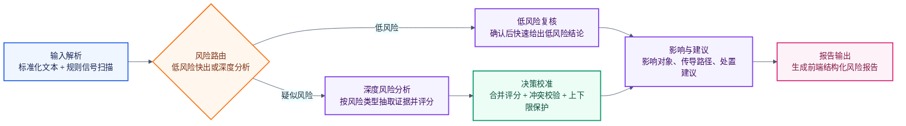

# Chat Agent LangGraph 简化结构图

这份文档对应当前 `chat_agent` 的 LangGraph 汇报图。图中把多个内部节点合并为阶段，便于演示时快速说明主流程。

- 代码入口：`backend/app/agents/chat_agent/graph.py`
- 节点实现：`backend/app/agents/chat_agent/nodes.py`
- Mermaid 源文件：`docs/chat_agent_stategraph.mmd`
- 导出图片：`docs/chat_agent_graph/chat_agent_stategraph.png`



## 简化主流程

```text
输入解析
  -> 风险路由
       低风险   -> 低风险复核
       疑似风险 -> 深度风险分析 -> 决策校准
  -> 影响与建议
  -> 报告输出
```

## 阶段职责

| 阶段 | 对应内部节点 | 作用 |
|---|---|---|
| 输入解析 | `normalize_input`, `fast_signal_scan` | 标准化用户文本，扫描高危、降级、封顶等规则信号。 |
| 风险路由 | `adaptive_router` | 根据规则信号选择低风险快出或深度分析路径。 |
| 低风险复核 | `low_risk_gate`, `fast_exit_decision` | 对低风险路径做二次复核，确认后快速生成低风险结论。 |
| 深度风险分析 | `risk_type_branch_analysis` | 按命中的风险类型抽取证据、识别风险类别并生成分支评分。 |
| 决策校准 | `deterministic_decision_engine`, `validation_gate`, `conflict_validator`, `apply_validation_decision` | 合并分支评分，并处理冲突校验、分数上下限和强证据保护。 |
| 影响与建议 | `final_context_agents` | 补充影响对象、风险传导路径、处置建议和评分拆解。 |
| 报告输出 | `report_generator` | 将结果转为前端可展示的结构化风险报告。 |

## 关键状态字段

`chat_agent` 在 LangGraph 中共享 `RiskCaseState`，主要字段如下：

| 字段 | 写入节点 | 说明 |
|---|---|---|
| `message` | 初始输入 | 前端聊天窗口提交的原始文本。 |
| `case_input` | `normalize_input` | 标准化后的输入对象。 |
| `signal_scan` | `fast_signal_scan`, `risk_type_branch_analysis`, `final_context_agents` | 规则扫描结果、场景分数、调试信息和后续 Agent 输出。 |
| `orchestration`, `orchestration_path` | `adaptive_router`, `low_risk_gate` | 当前路径选择和路由原因。 |
| `active_scenarios` | `adaptive_router`, `low_risk_gate` | 当前需要重点分析的风险场景。 |
| `evidence`, `risk_type_branches` | `risk_type_branch_analysis`, `fast_exit_decision` | 字段级证据、缺失证据和风险类型分支结果。 |
| `decision` | `fast_exit_decision`, `deterministic_decision_engine`, `apply_validation_decision` | 最终风险分数、等级、状态、主场景和校准记录。 |
| `needs_validation`, `validation` | `validation_gate`, `conflict_validator` | 是否需要冲突校验，以及校验建议。 |
| `final_context_agents` | `final_context_agents` | 影响分析、建议生成和上下文调试信息。 |
| `report`, `report_mode` | `report_generator` | 前端最终消费的风险报告。 |

## 导出图片

Mermaid 源文件已经保存在 `docs/chat_agent_stategraph.mmd`。需要重新导出图片时，使用项目已有 CLI：

```bash
./frontend/node_modules/.bin/mmdc \
  -i docs/chat_agent_stategraph.mmd \
  -o docs/chat_agent_graph/chat_agent_stategraph.png \
  -b transparent \
  -s 2 \
  -p docs/chat_agent_graph/puppeteer-config.json
```
