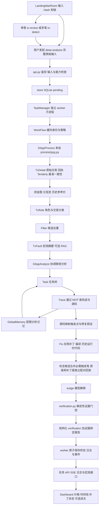

# AttackPilot 迁入与交接

## 2026-10-23 截图中的构造器变化误判与修订提前终止

本地任务 `9d6ce187-8c24-4832-817e-e9a6bc5198a9` 与截图的 `runtime_generation / blocked / constructor_or_immutable_changed` 一致。该任务只生成过一份补丁，累计预算还剩 14 次，`replay_attempted=false`、`replay_completed=false`；停止发生在回放前的 runtime 准备阶段，不能解释为补丁已回放但未拦住攻击。

只读重建该任务已保存的原源码与实际补丁，使用已安装的原版本编译器在隔离临时目录内编译，确认两份源码均可编译。初始化签名只有两处差异：`Auction` 与 `Game` 构造调用中 `IdentifierPath.nameLocations[0]` 的源码坐标分别从 `6045:12:3`、`7961:7:3` 移动到 `6639:12:3`、`8935:7:3`。构造调用的名称与参数、原初始化表达式未变。旧比较函数把这些坐标当成业务内容，错误地拒绝了补丁。另用合成源码复现了 `VariableDeclarationStatement.assignments` 中 AST 节点编号移动造成的同类误判；旧测试只在构造器之后添加运行时代码，未覆盖这些次序和继承场景。

本轮修复：

- **精确归一化编译器元数据**：仅在对应节点类型上忽略 `IdentifierPath.nameLocations` 与 `VariableDeclarationStatement.assignments`；仍比较真实声明、初始化值、构造调用名称和参数。真实构造器、初始化表达式及 immutable 改动继续拒绝，不移除完整性门槛。
- **候选补丁有界修订**：`constructor_or_immutable_changed`、`storage_layout_changed`、`patch_runtime_unchanged` 不再在第一次本地拒绝时结束整个任务，而是把具体诊断交回现有修订循环。任务累计 15 次生成预算不重置；重复的已拒候选不再编译，生成次数仍计入预算。原始历史证据不符、布局信息缺失、immutable 数据异常及未知错误仍终止，不以重部署绕过。失败候选的部分 runtime 不进入下一次尝试。
- **保留拒绝原因与记录**：候选摘要、拒绝原因及生成序号进入 `rejected_patch_candidates`；预算耗尽保留真实最后原因与最后应用补丁，同时单独记录预算停止原因。回放证据完成独立判定后，再深拷贝该诊断历史到最终验证结果，避免记录丢失、共享嵌套数据或影响通过依据。

同一份已保存补丁在修复后本地通过初始化签名、历史原版 runtime、存储布局及 immutable 移植校验。**这只证明截图中的准备阶段误判已解除，不代表实际攻击回放通过或补丁业务效果已验证。** 没有调用模型、RPC 或 Tenderly，没有修改历史任务、报告或原始证据，也没有把该真实案例加入回归案例库。

`REPORT_POLICY_VERSION=18`，`ANALYSIS_POLICY_VERSION=11` 保持；新报告执行不复用旧终止结果。测试扩展现有入口，合成输入与本地诊断编译文件均自动清理。

验证：模型与工作流、失败与证据完整性、本地编译三个现有入口及既有源码查找测试类，共 **231 项通过，零跳过、零排除**，其中编译入口 49 项。新增覆盖运行时代码位于构造器之前、局部变量 AST 编号变化、继承与显式基类构造调用，以及真实初始化改动仍拒绝；修订流程覆盖候选拒绝后修正、重复候选去重、跨轮累计预算、取消、部分 runtime 丢弃和最终诊断历史。实际分析调度的合成回归同时检查合规与不合规回放证据，历史记录不改变最终判定。父进程及 Python 子进程均阻断外部 socket / DNS；隔离 runtime、work、数据库与输出捕获结束后已清理。Python 语法与 `git diff --check` 通过；未重跑前端、完整 API 或真实攻击回放。

## 2026-10-23 当前目标：未知案例也必须完成复盘闭环

用户要求的最终结果是：现场输入系统从未保存过的攻击案例，也能完成交易取证、攻击路径还原、根因定位、补丁生成、实际执行验证和一致的报告展示。修复公共错误只是开发工作，不能据此宣称已经交付“每个案例全链路成功”。

最终验收须同时覆盖：

1. 输入不依赖案例库、名称白名单、固定 Hash 或预存报告；输入的链和交易身份贯穿所有阶段。
2. 根因与修复目标可追溯到本次取得的源码、调用和状态证据，不能把模型建议当作已证实结论。
3. 实际补丁成功应用、按目标合约真实编译设置编译，并匹配历史 runtime、存储布局和 immutable；“支持较新 Solidity”不等于把历史源码强制迁移到一个新版本。
4. 原版复现攻击条件，补丁版实际执行并消除该条件。补丁有效性不能只限于新增字面量 `require/revert` 的某一种修复形式。
5. 多交易攻击按顺序传递状态，正常业务能够执行，资金与状态结果可核对；独立交易拦截不能代替这两项验证。
6. 工作流、数据库、页面与导出均绑定同一份证据和补丁。`completed`、报告交付、编译通过、`skipped` 或 `unverified` 均不能单独计作上述完整成功。

**开发约束持续有效**：不得用真实案例逐个接入、提交任务或调用远程模型/模拟服务来试跑，避免用户指出的 Daybreak 触发问题；不得借历史报告为新输入生成结果。开发验证使用生成的 Hash、地址、名称、源码和服务响应，保留必要的本地编译及完整性检查。合成响应是测试输入，不是实际链上执行证明。

本轮继续修复公共链路：

- **未知输入准入**：移除旧批处理入口只处理 `SushiSwap` 的名称筛选，并取消默认扫描 `dataset/raw`。批处理只接受显式输入列表或 JSON 路径；CLI 无参数只显示 usage，不初始化工作流或提交存量案例。同名输入保留各自结果且避免结果键冲突，新批次不混入上一次的报告。单任务 worker 继续使用公共单任务入口。批任务失败或取消后等待所有子任务退出，避免后台继续分析。
- **普通 Agent 总上下文预算**：按完整消息、系统语言规则和历史 reasoning 计算预算，仅移除完整旧对话轮；保留当前输入与系统指令。格式纠错不再带入孤立的旧 assistant。必要输入本身超预算时明确失败，不向模型发送被静默截断的新证据；这仍不代表任意规模证据的分块调查已实现。
- **补丁模板与编译设置**：修正旧版重入锁初始为锁定的错误；区分 Solidity 0.6 的 `s_slot` 与 >=0.7 的 `s.slot`。移除示例中重置 owner、业务 limit 和杜撰阈值的内容；每份源码附实际版本、EVM 与 optimizer 设置。完整示例通过真实 patcher 应用后编译。
- **调查与补丁目标源码恢复**：两个调查源码工具和补丁取源共享按会话/地址最多一次的补取预算，仅对明确 `failed / retryable` 的失败恢复；同址跨交易本地复用成功结果。缺源诊断文字、空串与纯空白占位均不再当作已取得源码，重复失败保留真实获取失败状态。恢复后清理目标源码映射缓存并重新按编译器定位；映射仍不可用时不借旧 provider 文件编号补签目标。补取不重做交易模拟、不消耗补丁生成次数，保留各树历史字节码、轨迹和基线。新文件使用未占用编号，保留已有路径编号及已移除文件的编号；旧编号冲突保守拒绝。无配置、重复失败或确认为未验证源码时仍明确诊断，取消传播。
- **原生编译器输入兼容**：标准 JSON 按原文件字节通过 stdin 传入，兼容旧原生编译器，保留 Unicode、CRLF 和空白。超时与取消仍回收编译进程，并验证大输入阻塞时 stdin 正确关闭。
- **已记录结果的报告交付**：最后一次报告文字整理超时或返回无效正文时，若已有完整调查假设、轨迹和输入交易身份，直接整理这些记录并保留原验证状态与实际补丁；`report_generation` 记录整理方式。没有调查资料时不生成占位完整报告，取消、证据错误和程序错误仍传播。该分支解决已有结果的交付，不补造根因、执行证据或通过结论。

此前这一批修复使用 `REPORT_POLICY_VERSION=17`、`ANALYSIS_POLICY_VERSION=11`。没有重启服务、重新执行生产任务或修改历史任务结果。

验证：模型与工作流、失败与证据完整性、本地编译三个现有入口及既有源码查找测试类，共 **219 项通过，零跳过、零排除**，其中编译入口 46 项。覆盖显式输入入口、同名结果隔离、调查/补丁共用源码恢复预算、占位源码和文件编号冲突。完整补丁样例通过生产 `Solc.compile_json`，在 0.5.17 / 0.6.12 / 0.7.6 / 0.8.23、optimizer 开/关组合下完成 16 次原/补丁编译；不包含 EVM 正常/攻击行为执行。报告交付回归同时核对真实 SQLite 落库、任务详情读取和 `TASK_FINAL` 的正文与整理状态一致，未确认结论保持未确认；已有通过证据的报告仍须重新经过原始 artifact 和 runtime 完整性门控。真实总 deadline 与用户取消分别验证。此前挂起的进程内 MCP 检查已改用生产 stdio 子进程路径，完整执行并正常退出。

测试父进程与 Python 子进程均在 socket / DNS 层阻断外连，runtime、work、数据库、编译输入、输出捕获与网络隔离脚本均在临时目录或自动关闭文件中，结束后已清理。只扩展现有回归入口，未新建持久测试文件；没有重跑前端、完整 API 或翻译测试组。

**尚未达到最终验收**：当前回放协议仍为各交易独立历史状态，未实现整条攻击链连续状态回放；正常业务回归仍未执行；非回滚型补丁尚无通用执行效果判定。这些是必须继续补齐的能力，报告整理和以下离线回归均不能代替。

连续回放也不能通过简单合并现有请求完成：Tenderly REST bundle 虽承接前一步状态，但某一步失败后会停止后续步骤。后续实现必须区分“已执行前缀观察到拦截”与“整条链已执行完成”，不能为缺失后缀补签通过；独立历史结果也不能拼接为连续状态证明。见 [REST bundle 官方参考](https://docs.tenderly.co/api-reference/simulator/simulate-bundled-transactions)与[官方嵌套状态覆盖示例](https://docs.tenderly.co/simulations/bundled-simulations)。本轮仅查阅公开接口文档，未调用模拟 API。

## 2026-10-23 此前记录：面向未预存输入修复公共链路

用户明确要求每次攻击复盘都能走完分析、根因定位、补丁生成、实际回放和结果展示，现场输入也可能是系统从未保存过的案例。后续工作的对象是这条公共执行链，不能继续用“导入一个真实案例、付费试跑、再针对它修补”的方式推进，也不能把固定案例的结果当作新输入的分析结果。本文下方的历史真实试跑记录只说明当时做过什么，不代表继续采用该验证方式。

完整通过必须对应输入绑定的交易证据、可追溯的根因与修改、实际配对回放及一致的报告/页面结果。仅返回 `completed`、生成报告、正常退出，或者给出 `unverified / skipped`，均不能计作攻击复盘全链路成功。离线合成回归也不能冒充真实链上攻击的执行证明。

本轮直接修复四项公共缺陷，没有接入新的真实案例、调用模型或 Tenderly、提交真实任务或改写历史结果：

- **探索失败可纠正**：此前模型只要在合法探索工具中选错一次节点，`MCPToolError` 就终止整个任务。现在限定探索工具的一次 `remote_error`，重新核实当前树仍可读取后返回明确失败反馈，允许纠正选择；失败批次剩余调用不执行。重复失败、取消、传输、当前树、会话及交易切换错误仍传播，失败请求不作为补丁证据。
- **编译保留原源码**：移除对 Unicode、Tab、BOM 和 CRLF 的改写。此前 JavaScript fallback 会改变字符串字面量及 UTF-8 源码范围，使可编译的正确源码在历史 runtime 校验时被错误阻塞。新增合成源码反例在修复前真实失败，修复后本地编译通过。
- **报价去重贯穿宏观阶段**：共享无损报价引用逻辑，角色分类和根因摘要均使用完整引用表，根因摘要也保留多行初始调用树。新增三个生成 Hash、80 条资金边的合成输入经过两个实际 Agent 的提示构建；超过 70 万字符的原图压至十分之一以内，所有边、原始量、未知精度、完整调用树与两种不同链身份的报价均保留，原证据不变。该方法消除重复内容，不表示任意规模输入均已解决上下文限制。
- **失败回收并发任务**：交易属性与详情阶段中，一笔失败或父任务取消后，取消并等待全部兄弟任务结束，保留原始异常，避免已结束任务继续进行模拟或缓存写入。

`REPORT_POLICY_VERSION=16`、`ANALYSIS_POLICY_VERSION=10`，避免新执行复用旧宏观或报告缓存。没有重启服务或触发已有任务重新执行。

验证：178 项离线回归通过，覆盖数据、调查恢复、调度、缓存、回放与结果证据边界；42 项本地编译检查通过，零跳过，共 220 项。主回归隔离 work/database，并在 socket 层禁止外部连接。已知的进程内 FastMCP 收尾挂起用例未计入 178 项，API/翻译与前端检查本轮未重跑。以上是所覆盖环节的验证结果，不能宣称所有未知攻击的完整复盘已经达到 100% 成功；当前协议仍没有实现顺序传递状态的整条攻击链回放与正常业务回归。回归追加到现有入口，未新增临时测试文件；隔离数据库、输入、编译脚本和测试目录均随临时目录清理。

## 2026-10-23 深度调查被初筛提前结束

截图对应最新任务 `fc37d314-f49d-408b-906b-4327e2e8c14e`，输入为 Game 交易 `0x0eb8f8d148508e752d9643ccf49ac4cb0c21cbad346b5bbcf2d06974d31bd5c4`。原交易与回执已经通过一致性校验；本次没有生成补丁或执行补丁回放。`processed.json` 记录 `attack_transactions=[]`、全部输入被列入 `auxiliary_transactions`，因此旧调度直接产生 `fault_localization / skipped / no_attack_evidence`。这次停止发生在根因调查之前，不能解释为补丁已执行但无效，也不能解释为交易安全。

角色模型以缺少源码、调用细节为由未保留调查候选，但系统已经取得包含 `makeBid → 回调 → 折叠子调用` 的初始调用树。实际问题是：分类提示没有传入 `trace_tree`，并要求先确定“真正触发故障”再允许深入调查。资金图又逐条重复完整价格来源资料，714,404 字符中存在 91 份相同报价，挤占模型上下文。资金净流入本身仍不足以证明漏洞，修复没有按获利金额强行判定攻击。

本轮修复：

- 初始调用树完整传给角色分类；`attack_transactions` 明确表示待进一步核实的故障触发候选，角色、收益和缺失日志均不能单独确认攻击或安全。
- 已启用 `fault_localization` 时，按历史顺序保留全部提交交易作为调查目标，初步攻击/辅助分类继续单独保存。新增 `investigation_scope` 传递调查目的；任务与调试提示明确辅助标签不能跳过显式目标。
- 调试器新增本地 `finish_investigation` 工具，普通轮次和限额收尾都可在无可验证假设时正常结束，进入 `unverified / no_attack_hypothesis`；不强行编造补丁。仅接收非空原因，拒绝额外结论字段，终结后不执行同批后续工具。
- 仅在角色提示中用引用共享完全一致的完整报价，不修改原始图、余额或证据。用本次任务资料无损往返验证，图缩至 40,367 字符，包含调用树的完整角色提示为 63,688 字符；资产身份、数量、精度及未知值均保留。
- 尚未尝试回放时，报告明确显示“未执行回放 / 攻击路径拦截未执行”，并列出停止原因，避免统一显示“证据不足”。`REPORT_POLICY_VERSION=15`、`ANALYSIS_POLICY_VERSION=9`，新任务不复用旧筛选策略缓存。

验证：角色/调查/缓存/模型边界 **41 项通过**，失败与回放证据及真实本地编译 **113 项通过**，合计 **154 项相关回归通过**；实际任务资料的调用树输入和报价无损往返检查通过，`git diff --check` 通过。原有进程内 MCP 客户端测试单独执行虽输出 `ok`，收尾仍不结束，已超时停止并在上述 41 项中排除；完整五组未全部完成，API/翻译组没有计入本轮通过数量。

本轮没有调用模型或 Tenderly，没有重启服务、重跑付费任务或改写历史结果；截图中的历史任务仍保留当时记录，后续新执行才会使用修复后的流程。回归扩展既有测试入口，未新建临时测试文件；测试临时数据库与目录已清理。

## 2026-10-23 补丁回滚位置绑定与传播归因修复

本轮处理两项：同合约旧校验与未执行的新校验使用相同错误文案时可能误判通过，以及 BBToken 最新任务的回滚归因。第一项已用本地反例复现并修复；第二项进一步检查后确认，`kj` 不是可以直接放行的通用错误包装，不能把该任务改成验证通过。

- **实际修改校验定位**：`FixAgent` 根据实际原/补丁源码、编译 AST、源码映射和最终覆盖 runtime 生成 `replay_evidence.patch_attribution`，记录补丁、runtime、文件及 guard 的 SHA256、UTF-8 源码范围和真实 `REVERT` PC。判定必须匹配回放观测的失败 PC，或匹配具有文件名和源码摘要身份的失败源码范围。供应商 file ID 不直接当作编译器 source ID，`caller_pc` / 函数入口 PC 不作为失败位置。缺失、非法或相互矛盾的位置保持未确认。
- **优化器与共享错误路径**：同文案多个 guard、动态 `require/revert` 文案、assembly revert、无法唯一对应的新校验，以及共享回滚指令均保守拒绝。真实优化编译反例曾将旧 `require(x > 1, why)` 与新 `require(x > 2, "denied")` 共用 PC 160，即使源码映射标为新 guard 也不能据此通过。
- **父级传播证明**：不再将相同文案、`call failed`、`execution reverted` 或末端调用关系单独当作因果证据。新增有界局部字节码证明，精确核对实际父 runtime、调用 PC/类型和双方输出；失败返回位分支须产生当前回滚输出，成功返回位分支须绕过该显式回滚。支持可证明的 assembly 转发和固定内存错误包装；未知控制流、状态读取、证据不足的动态内存及 CREATE/CREATE2 父帧保持未确认。该证明不验证 Gas 充足或正常业务行为。
- **原始 artifact 与旧结果**：最终落库重新读取真实 artifact，重算执行摘要、位置及传播证明，核对实际覆盖代码中的指令边界，再运行确定性判定。伪造摘要中的失败 PC、补丁文件或共享指令不能通过。新 `verification_policy_version=2`、`TRACE_SUMMARY_POLICY_VERSION=5`、`REPORT_POLICY_VERSION=14`；宏观 `ANALYSIS_POLICY_VERSION=8` 保持。缺少当前验证策略的旧通过记录在 API、页面及导出降为未确认，不自动补签通过。

### BBToken 任务的真实复核结果

任务 `3d344ca7-74ed-462a-9b36-56183e1a7ca6` 的原版和补丁版轨迹在当前解析器均为 `complete=true`。父合约 `0xf5610cf8c27454b6d7c86fccf1830734501425c5` 的缓存字节码在 PC 8374 执行 CREATE2，随后丢弃返回值；`kj` 来自 PC 5803 附近的后续数值条件检查，不能解释成已证明的直接错误转发。修改实现的历史补丁轨迹也没有可绑定的新失败 PC/源码范围。重新编译不能补造这些实际执行观测。

已重新校验原始回执、两份 artifact 的 SHA256、请求与历史上下文、实际 runtime 摘要，并将该任务从旧 `patched_trace_format_unsupported` 更新为 **`unverified / revert_propagation_unproven`**，同时记录 `patch_guard_location_unproven`。后续动作为补充缺失证据，不自动反复改写补丁。原报告/result 备份在该任务 `evidence-revisions/335e0ed869984617dbdb1d904db0922ce4050925ad68b626aabebb816d42d76a.json`；原始模拟 artifact、日志与模型用量保留，报告、result 与 `TASK_FINAL` 原子更新。

离线复核工具增加 `--refresh-unverified`：仅允许已未确认任务在原始证据核验后更新诊断，仍不能把证据不足改成通过；默认复核仍要求完整通过才允许升级。

```bash
cd backend
PYTHONDONTWRITEBYTECODE=1 .venv/bin/python -m app.attackpilot.revalidate <task_id> --refresh-unverified
PYTHONDONTWRITEBYTECODE=1 .venv/bin/python -m app.attackpilot.revalidate <task_id> --refresh-unverified --apply
```

验证：后端五组 **222 项通过**，前端 **51 项通过**，TypeScript、改动前端文件 ESLint 与 `git diff --check` 通过。新增覆盖真实编译的同文案/动态文案/assembly/共享 PC、UTF-8、真实字节码转发与自定义包装、未知成功返回数据边界、旧策略降级、原始 artifact 对观测位置和归因的绑定，以及未确认诊断刷新；最终落库的伪造 PC/归因反例另外重跑通过。本轮没有新增模型或 Tenderly 调用，没有重启或发布服务。测试扩展现有入口，未新建测试文件；隔离编译、测试目录已清理，正式审计备份保留。

## 2026-10-22 展示前的新 Hash 与结果完整性检查

本轮按“新输入交易 → 原始交易与回执 → 金额和参与者 → 模型分类 → 补丁应用与代码替换 → 配对回放 → 报告落库 → 页面/导出”继续检查。目标是让失败、缺失证据和不支持的能力明确暴露，不能把它们包装成攻击成立、补丁有效或交易安全。模型解释仍需证据复核；本轮结果不构成任意 Hash 都会成功、任意根因推断都正确的保证。

### 新截图：有源码却显示缺少源码

任务 `5a916b33-33c1-4add-ab69-372c4c49991d`，输入 `0x4019890fe5a5bd527cd3b9f7ee6d94e55b331709b703317860d028745e33a8ca`，在实现合约 `0x74463ed91bfa45bca06d59e8b383a89709842f69` 返回 `missing_source`。实际原因是 **源码下载失败被误归类**：该任务 `worker.log:53` 明确记录目标源码请求 `ConnectTimeout`，同批其他地址也连接超时。系统已从 BEAN 代理的 DELEGATECALL 找到正确实现；原模拟的 contracts 不含此实现，但 addresses 包含它，因此确实尝试过区块浏览器补取。

实时查询[目标合约源码](https://etherscan.io/address/0x74463ed91bfa45bca06d59e8b383a89709842f69#code)确认 BBToken 已验证，源码 44,477 字符，Solidity `v0.8.20+commit.a1b79de6`，历史 runtime 4,253 字节。这不是“Hash 无效”或“合约未公开源码”。精确 0.8.20 编译器已从官方源安装，SHA256 `0479d44fdf9c501c25337fdc540419f1593b884a87b47f023da4f1c700fda782`。下载失败使用 `source_fetch_failed`，已确认未验证使用 `source_not_verified`，保留 `missing_source` 兼容旧记录；旧任务不自动改写成成功。

已补有限重试（短暂网络/408/429/指定 5xx 最多再请求一次）、最多 3 并发、失败原因透传、取消回收；源码补充保留编译设置、EVM、库链接及 ABI。使用实际 `ContractSourceDownloader → TenderlyDao._supplement_missing_contracts → ContractDao` 在隔离目录验证，成功取得 10 个源文件，以 0.8.20 / Paris / optimizer 200 编译，得到 4,253 字节 runtime、2 项 storage、1,477 条源码映射，runtime 与区块 19417823 的链上代码逐字节相等。

**随后补通函数映射**：原始轨迹缺少函数源码位置时，使用相同编译设置生成 AST，以真实外部调用 selector 和目标合约的线性化继承顺序定位函数；编译文件 ID 再按文件名映射回实际源码记录 ID。不会改写原始轨迹 PC/源码位置，推导来源单独标为 `compiled_ast_function_selector`。真实目标已确认 `10267 → setRegistry → BBTOKENv2.sol:52`、`11287 → mint → BBTOKENv2.sol:31`，继承的 `approve` 也能定位至 `ERC20Upgradeable.sol:155`。真实 MCP 补丁入口对前两项均返回 `file_index=8`；全部 10 个源文件和编译参数保留。补丁生成前仍须通过历史 runtime 严格校验。未知 selector、无法唯一识别的实现、内部跳转和不支持的 getter 保持明确拒绝；识别入口函数不表示证明函数体每条指令均执行。

### 新交易真实执行

用户明确要求测试现有案例之外的 Hash。本轮从配置的 Ethereum RPC 读取新区块，筛选成功的普通 ETH 转账和 ERC20 转账，并检索现有任务输入、演示种子、原始案例和文档中的 275 个 Hash，确认下面两笔未收录。没有用已有报告替换新任务结果，也没有通过案例名称告诉模型应返回什么结论。

| 类型 | 新 Hash | 区块 / 实际 Gas | 完整流程结果 | 耗时 |
| --- | --- | --- | --- | --- |
| ETH 转账 | `0xd98be6b84aafc03d294775557d389fe9b6a1d286f4e45964e7e2a0022f6c00d9` | 26247350 / 21000 | completed；原始回执一致；no_attack_evidence；无补丁生成/回放 | 81.48 秒 |
| ERC20 转账 | `0xb28203fdf8ee5b01651991b2abecbdba8d3fe7f05e6e5f20ce23dbb1e210b67a` | 26247350 / 62272，1 条事件 | completed；原始回执一致；no_attack_evidence；无补丁生成/回放 | 59.84 秒 |

两笔均启用完整模块，实际经过 RPC、Tenderly 原版模拟、MCP 和模型分析；不是 mock 或缓存报告。分类为空攻击候选、保留辅助交易，`safety_confirmed=false`。未建立攻击证据不表示证明交易安全，也不能用这两笔正常交易证明攻击补丁回放成功。测试使用自动清理的隔离目录，不创建生产任务；测试记录不出现在正式任务列表。

### 修复的实质问题

| 环节 | 原问题 | 现在的行为 |
| --- | --- | --- |
| 金额 | Tenderly 十进制 Wei 字符串按十六进制解析；未知 decimals 默认 18 或以 -1 放大数值 | 严格区分十进制/0x/int，显示原始量；未知精度保持未知。回归锁定 `294000000000000000 Wei = 0.294 ETH` |
| 事件与资金图 | 原始 logs 未传递；部分 asset_changes 遮盖其他转账；decoded/amount 覆盖 raw；NFT tokenId 当金额 | 保留原始事件并避免重复，优先原始 ERC20 数量；NFT 不按同质代币数量及美元估价 |
| 摘要和角色 | 摘要缓存未绑定当前数据；模型可凭空列出格式合法的攻击者/受害者 | 缓存绑定当前证据、链与提示策略；拒绝非法摘要与不在当前证据中的角色地址 |
| 候选筛选 | 模型可删除不同攻击模板 | 没有确定性等价证明就保留全部候选；模型只能调整调查顺序，补回时记录 filter_degraded |
| 原版轨迹 | 外层交易/回执一致，但嵌套调用树可以属于其他输入 | 原版及补丁版均核对根调用 from/to/input/value、调用类型和显式状态；矛盾记录停止分析 |
| 补丁应用 | 去空格/注释误改字符串；空 SEARCH 或部分失败仍可能成功、污染源码 | 字符串含义保留，补丁块严格解析；失败原子回滚所有文件 |
| 历史 runtime | 不匹配的原版代码、同名 immutable、缺值默认 0 可能造成虚假回滚 | 逐字节核对原指令，只允许识别过的 metadata hash 和 immutable 差异；按文件/合约/名称/类型匹配 immutable |
| 存储与初始化 | 改槽位、字段类型、继承顺序、构造器/初始化值后仍拿旧状态执行 | 严格检查 storageLayout、初始化和 immutable；不一致明确阻断；可执行 runtime 不变也不能当作有效代码修改 |
| 部署回退 | 校验失败后用不同初始化的重新部署结果绕过检查 | 删除部署 fallback、对应旧 Tenderly 方法与私有格式化器；验证只使用已校验历史状态的 runtime 替换 |
| 最终结果 | 空模型输出可被状态前缀包装成报告；报告/输入/回执/补丁证据可能不一致仍 completed | WorkFlow 与 worker 双层结果检查；verified 还需输入回执一致及 runtime/storage/immutable 校验记录，与实际补丁 SHA 绑定 |
| 页面与评分 | 哈希、工具调用或“补丁失败”关键词被当成已验证；长 calldata 被截成交易 Hash | 文字关联与证据核验分离；验证卡片、导出和闭环评分使用机器状态；不从首尾交易猜攻击准备/获利角色 |

新增原因包括 `original_runtime_mismatch`、`storage_layout_unavailable`、`storage_layout_changed`、`immutable_layout_mismatch`、`constructor_or_immutable_changed`、`patch_runtime_unchanged` 和 `analysis_report_invalid`。不具备 storageLayout 的旧编译器（例如 0.4.24）可以编译，但当前不能据此安全验证 runtime 替换，会明确停止；不能用构造部署绕过这个限制。

`replay_evidence.runtime_integrity` 保存实际修改地址的原始/编译/补丁 runtime SHA256、storage 与 immutable 检查结果，以及实际补丁摘要；仅覆盖真实修改地址。最终门控还读取真实回放 artifact，校验文件与请求摘要、历史交易参数，并重算实际覆盖代码的 SHA256；附加 storage 修改、错误代码或缺失文件均拒绝。已有 Game 的 6,881 字节 runtime、15 项 storage、2 个 immutable 通过严格本地核验。旧任务及历史 artifact 不自动重写，也不声称已经补跑了本轮新增检查。

当前缓存策略为 `REPORT_POLICY_VERSION=13`、`ANALYSIS_POLICY_VERSION=8`。根因正文明确标注为分析解释，不能覆盖结构化的验证范围、失败原因与正常功能未回归状态。

### 验证与清理

最终后端整套五组 **203 项全部通过**。覆盖多文件函数定位、继承/override/重载、UTF-8 字节位置、第三方 source ID 与编译 ID 不一致、源码超时与未验证区分、有限重试和并发、非法模型输出、跨输入证据、缺失原始回执、真实 artifact 篡改与代码绑定、伪闭环评分、金额/精度/NFT、候选遗漏，以及真实 Solidity 编译、storage/immutable/构造变更和 MCP 子进程。

前端 **50 项测试通过**，TypeScript 与变更文件 ESLint 通过；隔离生产构建完成编译、Next 类型检查、22 个静态页面及构建追踪。浏览器只完成桌面首页和任务库检查；隔离开发服务冷编译/导航超时，未完成全部桌面与手机页面验收。浏览器、测试服务及其临时目录已清理。测试均扩展已有入口，不新建测试文件；真实试跑的临时源码、日志、缓存和模型结果随隔离目录清理，正式任务与已有 `.next` 未被覆盖。

## 2026-10-22 补丁验证截图：Solidity 0.8.23 编译阻塞

复核最近两次任务 `1083b6e9-a2f7-4810-8970-aba9f0e060aa` 与 `0d61ac87-d9dd-448d-96dd-17b7de6a2567`，均停在 `blocked / compile / original_compile_failed`。输入交易为 `0x0eb8f8d148508e752d9643ccf49ac4cb0c21cbad346b5bbcf2d06974d31bd5c4`，失败目标是 Game 合约 `0x52d69c67536f55efefe02941868e5e762538dbd6`。原始源码要求 `v0.8.23+commit.f704f362`，当前环境原生编译器和 JavaScript 编译器原先最高只到 0.8.19。该任务尚未生成补丁或执行补丁回放；页面显示的相关记录数量不代表完成了相应次数的验证。

本次修复：

- 补齐精确原生编译器。新增显式安装入口，依据 Solidity 官方稳定版本清单匹配版本和 commit、校验 SHA256 与实际 `--version`，限制下载大小及超时，原子安装并清理失败下载。实际任务执行不自动下载编译器。
- 原生版本查找改为完整版本及 commit 匹配，防止 `0.8.1` 误选 `0.8.14`，或者指定 commit 不存在时退到其他构建。JS fallback 也检查实际版本和 commit。
- 旧版 SolcJS 使用其支持的 standard JSON 入口；修复 `PUSH0` 源码映射解析，并在取消或超时后终止、回收编译进程。
- 缺少对应编译器返回 `compiler_unavailable`；真实源码编译错误保留 `original_compile_failed`。保存限量、脱敏的编译诊断，并写入补丁日志。页面展示目标合约、精确版本和下一步处理，不再只给出笼统编译失败。
- 报告缓存策略升为 10，分析缓存策略升为 5，避免新执行复用旧编译链路产生的结果。历史任务记录仍保留当时的实际状态。

安装命令（当前显式安装入口支持 Linux x86_64；版本可重复指定）：

```bash
cd backend
PYTHONDONTWRITEBYTECODE=1 .venv/bin/python -m app.attackpilot.prepare --compiler-version v0.8.23+commit.f704f362
```

安装依据为 [Solidity 官方静态二进制说明](https://docs.soliditylang.org/en/v0.8.23/installing-solidity.html#static-binaries)。已安装文件的 SHA256 为 `28726a452290c70e1984f15c53ad3088e7d98783ee3070b11b3664da77415732`，实际版本为 `0.8.23+commit.f704f362.Linux.g++`。

离线使用最新任务保存的 7 份真实源码及原编译设置，经过实际 `ContractDao → Solc → 源码映射` 路径，编译成功且没有编译错误：运行时字节码 6,881 字节、创建字节码 7,085 字节、2,850 条源码映射、45 项 ABI。与保存的链上代码比较，差异仅包含构造时填入的 `_canvas` / `dev` immutable 值与 metadata 的 IPFS hash；经过现有 immutable 移植，前 6,828 字节完全一致，剩余仅 metadata hash。

这证明本次原始源码编译阻塞已经解除，不能代替实际补丁的生成、编译与配对回放。本轮未调用模型或 Tenderly、未改写生产任务或补丁结果；旧任务需重新执行后，才能产生新的验证结论。新增回归均加入已有测试入口，未新建测试文件；临时编译和下载文件自动清理，正式编译器保留供任务使用。

最终验证：后端五组回归共 **150 项全部通过**（95 项基础、模型契约、翻译及本地编译集成，55 项失败分类与回放证据回归），前端 **43 项全部通过**；TypeScript、相关 ESLint 与 `git diff --check` 通过。编译集成包含实际 0.8.23 / `PUSH0`、旧版 0.4.24 JS、0.8.9 原生/JS 一致性及编译进程超时/取消回收；版本选择、缺编译器前置阻断、诊断脱敏和错误 commit 拒绝均有回归覆盖。

## 2026-10-22 当前工作树的全链路复查与实际清理

本轮从页面输入 Hash 重新检查当前代码，没有把下方历史修复记录当作验证结论。保留开始时已有的未提交修改，只补充仍可复现的缺陷，并实际删除已确认没有消费者的旧实现。

### 本轮核实的调用链

`LandingWarRoom / TaskList → services/api.ts → frontend/lib/api.ts → api.py → store.create_task → TaskManager → worker → WorkFlow → DAppProcess（pyg.py）→ TxDetail → 资金图 / 历史价格 → TxRole → Filter → TxFault → DAppAnalyze → Task / Trace / GlobalMemory → MCP / DebugSimulator → Fix → 原版与补丁版配对回放 → Judge → verification.adjudicate_patch_verification → report_evidence → worker / SQLite → public_task → 详情 / 列表 / SSE → Dashboard / 补丁面板 / 原始报告`。

单笔初审 `/tx-review` 与批量初审 `/tx-detect` 是轻量链上观测；用户随后提交 `/tx-review/deep-analysis` 才进入上述完整执行链。轻量 callTracer 的一致性检查不能代替历史配对回放证据。任务 `completed` 表示分析产物已经生成，不等于补丁验证通过。

### 仍然存在、现已修复的问题

| 环节 | 可复现问题 | 本轮处理 |
| --- | --- | --- |
| 前端提交 | 同一事件周期重复点击可同时 POST；离开页面后异步回调仍跳转或继续批量建任务 | 同步互斥、卸载取消和过期回调检查；初审与深度提交共用完整 Hash/模块校验 |
| 结果恢复 | 日志分页失败或迟迟未返回，阻断任务终态与报告刷新 | 独立先读取并发布持久化状态；日志失败单独显示，保留重试 |
| 批量初审 | 全部 RPC 不可用时，`unknown → needs_review → auxiliary_items` 被汇总成中风险 | 数据不足保留 `unknown`，不把可用性故障当可疑交易证据 |
| 初审身份 | 分别取得的交易、回执可能来自不同区块或位置；callTracer 根调用可能不对应输入 | 对齐 blockHash/blockNumber/transactionIndex；核对根调用、回执必需字段及受支持的调用类型，不一致不形成低风险结论；整数 `status=0` 正确保留回滚信号 |
| 队列重启 | 尚未开始的 pending 任务被一并标为失败 | 只中断旧 running，pending 继续排队 |
| 多进程调度 | 未取得锁的 API 进程直接返回，原持锁进程退出后无人接管 | 后备进程持续竞争文件锁，取得锁后先处理遗留 running 再执行队列 |
| 调试树 | 遇到预编译调用或低 gas STATICCALL 使用 `return`，后面的兄弟攻击分支不展开 | 仅跳过该节点；无效展开、折叠显式失败；注释批次先校验再更新 |
| MCP 工具错误 | 服务端捕获异常后返回普通 `Error ...` 文本，绕过客户端 `isError` 检查 | 使用 `ToolError`；真实本地 MCP 协议回归确认客户端收到 `remote_error` |
| Trace 切换 | 非输入 Hash 仍会提交远端切换 | 本地输入身份检查，有限纠正后停止；本地分析理解更新去掉无作用 MCP 往返 |
| 缓存路径 | 已命中完整报告仍启动 MCP；缓存宏观读取还重载轨迹；恢复的 TraceAgent 丢日志/取消回调 | 按实际需要启动 MCP，恢复回调；新鲜宏观处理仍需要原始轨迹和其编译依赖 |
| 轨迹判定 | `success=true` 与 `error_op=REVERT/INVALID` 同时出现可漏检；缺文案但有 REVERT 与 ABI 原因的失败未识别 | 矛盾轨迹归为 `patched_trace_invalid`；对真实失败保留可验证回滚信息 |
| 状态比较 | 供应商名称、decoded 内容、美元或浮点展示字段进入状态指纹，导致相同状态被判变化 | 规范化原始余额、资产变动和 storage word；忽略展示元数据，保留真实变化及重复记录次数 |
| 报告证据 | 只凭 schema/版本/`evidence_validated` 标记信任通过结论，换掉配对回放仍可显示通过 | 确定性门控生成完整 replay 的规范 JSON SHA256 与补丁摘要；渲染时重新匹配 |
| 验证维度 | 游离的 `normal_regression.passed` 或 `profit.usd` 可以伪装成实际完成的测量 | 当前 `attack_path_only` 协议统一显示正常回归未执行、利润不可确认 |
| API 与页面 | 报告渲染已收紧，任务列表/详情/旧 SSE 仍直接返回原 verification | `store.public_task` 统一只读规范化，并核对顶层实际补丁 SHA；历史事件读取应用相同规则；前端拒绝不完整标记 |
| SSE 修订 | 同一终态重复发送；旧 TASK_FINAL 在修订事件前发出，而客户端收到第一个就断开 | 首次终态事件读取最新持久化结果并结束；断线恢复无待发事件时仍提供当前终态快照 |

当前策略：`REPORT_POLICY_VERSION=9`、`ANALYSIS_POLICY_VERSION=4`、`TRACE_SUMMARY_POLICY_VERSION=4`。

### 删除与保留的边界

已删除 8 个无活跃消费者的文件：

- `process/nx.py`、仅该旧链路使用的 `daos/money.py` 和 `utils/diffusion.py`。
- `utils/api_client.py`、`utils/poc.py`。
- `prompt/fault_localization_prompt.py`、`prompt/final_report_judge_prompt.py`、`prompt/final_report_judge_prompt_comparative.py`。

同时删除旧同步 LLM/TokenManager/helper、未使用的签名/RPC/Etherscan/bundle/GlobalMemory 分支、旧 `TASK_END_UP` 提示、后端旧建任务 schema、未使用的请求字段与路由遗留常量。`llm.py` 不再初始化无人消费的 tokenizer，避免导入时的额外词表获取。首页硬编码 `false` 的旧教程与攻击路径 JSX、重复内容和对应状态也已实际移除；知识页及首页仍显示的统计保留。

仍有消费者的 `/task/{id}/log/{log_id}`、`automated-review`、学习页别名、业务 API 包装与公共 fetch 层保留；不能仅因名字相近就删除。完整模块依赖仍统一从 `schemas.normalize_modules` 产生，删去其后永远无法命中的“attack_detection 未启用”分支。

最终 AST 清点为 30 个 method/path：GET 18、POST 11、DELETE 1，没有重复注册；`backend/main.py` 只注册一次 AttackPilot router。扫描 backend 的 260 个 Python 文件，没有删除模块的残留导入或失效的 `app.attackpilot` 本地导入。

### 历史结果与真实执行边界

缺少新证据绑定的旧 live 通过记录，API 与状态面板会显示未确认；原始数据库记录、报告正文、日志和不可变 artifact 不自动重写。旧正文中的通过表述属于历史分析记录。离线复核工具扩展为接受符合已知旧格式的 verified 记录：必须重新校验原始 artifact、请求、历史身份与原始回执，再运行当前门控，才能生成新绑定；仍默认只读，`--apply` 才原子保存并留旧结果备份。已带绑定但不匹配的记录不能借兼容路径自动重新签名。

本轮没有提交真实付费模型或 Tenderly 模拟任务，也没有改写生产任务。单页互斥防止本页同时提交，不提供跨标签页/网络超时后的服务器幂等保证。正常业务回归、顺序传递状态的整条攻击链验证、未知资产历史价格覆盖仍是未实现或证据不足的能力，不能由“补丁拦截通过”推断为已完成。

验证命令（均在已有测试入口追加回归，没有新建测试文件）：

```bash
cd backend
PYTHONDONTWRITEBYTECODE=1 .venv/bin/python -m unittest evals.test_attackpilot evals.test_attackpilot_failures evals.test_attackpilot_llm evals.test_attackpilot_translation evals.test_attackpilot_compilers
cd ../frontend
npm test
npm run typecheck -- --incremental false
```

本地 TestClient 在当前受限沙箱内的跨线程事件循环会停滞，纯 FastAPI 最小反例同样复现；沙箱外该反例正常，API 与本地 MCP 集成回归在沙箱外运行。测试采用隔离数据库、合成 RPC/模型结果和本地编译器，生成的临时目录自动回收；测试未访问真实模型与模拟接口。

最终合并验证：后端上述五组 **135 项全部通过**，包含真实本地 MCP 子进程握手与 Solidity 原生/JS 编译及 AST 解析；前端 **42 项全部通过**，TypeScript、变更文件 ESLint、`git diff --check` 均通过。保留的是现有脚本中的回归用例；未新增测试文件或持久化 fixture，临时文件与 TypeScript 构建缓存已清理。

## 2026-10-22 多种交易结构的离线回归与故障分类

单笔交易成功只能证明该笔交易经过的分支可用。本轮把可重复的覆盖加入已有测试脚本，不依赖私有任务目录、网络、模型或付费模拟；没有新增测试文件或持久化临时 fixture。

- 回滚验证覆盖直接调用、同文案逐层回滚、两层包装、DELEGATECALL、零 gas 源码标记，以及被捕获的子错误、后续继续执行、无关回滚、缺失/截断/未知格式/矛盾轨迹、原版身份与必需触发交易缺失等反例。
- 回归实际发现并修复了文案相同的捷径：旧门控只在根、子错误不同时检查传播链，可能将“子错误已被捕获，后续执行后以同文案再次失败”误报为拦截。现在每个候选都必须通过连续终止回滚链检查，包括根调用；`INVALID` 不能因为文案像新增 `require` 而被认定为补丁校验回滚。修改合约转发未修改子合约的同名错误也不能通过；判定沿终止调用继续追到返回同名错误的最深调用，并核对该调用是否属于修改代码。
- 轨迹摘要记录固定枚举问题类型和位置，最多保留 16 个位置、每个路径 128 层；完整类型集合独立保留，避免第 17 个以后的结构异常被隐藏。缺失/截断仍为 `patched_trace_unavailable`，不支持的节点格式为 `patched_trace_format_unsupported`，结构或执行状态矛盾为 `patched_trace_invalid`。后两类不能触发自动重写补丁，应先修复或复核轨迹解析。新摘要策略版本为 3，报告缓存版本为 8。
- 价格的 14 项离线回归经过真实 Graph、TxRole 入口，覆盖不同交易/区块身份、同秒区块、历史区块提示与完整搜索结果一致、未来报价拒绝、未知 LP、RPC 乱序与取消回收、任务内共用和跨任务重新查询。
- 页面按具体原因显示“证据不足 / 无法验证 / 验证异常 / 判定待复核”和下一步。只有后端明确记录执行修改代码仍成功的分支显示“未建立拦截”，状态仍是 `unverified`；没有将异常改成验证通过，也没有把证据不足当作补丁无效。

回归入口：

```bash
cd backend
PYTHONDONTWRITEBYTECODE=1 .venv/bin/python -m unittest evals.test_attackpilot evals.test_attackpilot_failures evals.test_attackpilot_llm
cd ../frontend
npm test
npm run typecheck -- --incremental false
```

真实任务复核为只读：`167009e7…` 的 4 份 artifact、`0393fd8e…` 的 2 份 artifact 均重新校验 SHA256、请求、历史交易/区块及原始回执，再重建新版摘要、运行最终门控；两笔任务仍为 `verified / attack_path_intercepted`。没有新增远程调用或改写任务记录。正常功能仍未验证，利润仍不可确认，UNI-V2 历史报价覆盖缺口仍存在；这些限制与交易分析是否完成分别展示。

最终验证：后端 92 项通过（包含新增的 26 项回放与 14 项价格回归），前端 38 项通过，TypeScript 与所改前端文件的 ESLint 通过。测试生成的隔离临时目录已清理，没有新增临时脚本、测试文件或 fixture。

## 2026-10-22 新 Hash 的回滚轨迹误判修复

本次截图对应任务 `0393fd8e-df02-4a94-886f-7e29d8113ae2`，交易 `0x33479bcfbc792aa0f8103ab0d7a3784788b5b0e1467c81ffbed1b7682660b4fa`。任务实际执行了原版、补丁版各一次历史回放；不是前端沿用旧 Hash，也不是没有生成补丁。原版成功，补丁版在 StakingRewards 的新增 `withdraw amount exceeds balance` 检查处回滚，但两处解析限制让最终状态错误停在 `patched_trace_unavailable`：

1. Tenderly 在回滚处附带没有 `call_type` 的源码标记，错误文案是实际 `require` 原因。旧解析器只接受固定的 `execution reverted`，把完整的 39 节点轨迹判为不完整。新版校验标记与父帧的地址、错误、位置、源码坐标及零 gas 特征后识别它；任意缺字段的节点仍不能跳过。
2. 两层转发合约把子调用的错误包装为 `call failed`。旧门控要求根、子错误文案相同。新版要求完整轨迹中连续失败的终止调用链，允许通用包装错误，保存 `[] → [2] → [2,2]` 的检查依据。该检查证明当前输入被拦截，不声称已证明 opcode 级错误数据流、正常功能或整条攻击链。

`trace.policy_version=2`，新报告缓存版本为 7。使用原始不可变 artifact 重新校验文件 SHA256、请求摘要、历史请求、交易和区块身份、RPC 回执后，该任务已修复为 `verified / attack_path_intercepted`。位置为 `contracts/staking/StakingRewards.sol`、trace position `3933`。原完整结果保存在任务目录 `evidence-revisions/6332f46d480a3f7c4315f04dc57d85bea76e82136b626b7e22b53daf629cab82.json`；原始模拟、日志、时间和模型用量保留，报告正文明确标为原始分析记录。正常功能仍为 `not_run`，收益仍未知。

新增本地复核工具，默认只读预览，仅接受这两类历史轨迹判定失败；`--apply` 仅在完整证据重新通过时原子更新结果、报告和 `TASK_FINAL`，并先持久保存旧结果。它不会调用模型或模拟服务，也不会批量改写其他任务：

```bash
cd backend
PYTHONDONTWRITEBYTECODE=1 .venv/bin/python -m app.attackpilot.revalidate <task_id>
PYTHONDONTWRITEBYTECODE=1 .venv/bin/python -m app.attackpilot.revalidate <task_id> --apply
```

同一轮还修复了源码获取失败日志写入 MCP stdout、干扰 JSONRPC 解析的问题；补丁卡片将“9 条证据”更正为“9 条相关记录”，因为该计数包含报告片段及日志，并非已校验的回放份数。

价格是独立问题：本次 ETH 的 Chainlink 查询在 33 次 RPC 后达到 30 秒时限，DefiLlama 备选报价比交易晚 27 秒，不能当作交易前价格。此前报价器忽略已取得的交易区块信息，重复从创世区块定位历史时间。现在资金图和角色分析都传入区块号、区块哈希、时间；报价器经 RPC 重新核验该块及父块后直接定位历史状态。同秒区块仍向前搜索，后继发布、历史代理映射和哈希复核保持不变。独立元数据读取并发执行，每个请求固定自己的 JSONRPC ID，失败或取消会回收同组请求。

真实冷查询已取得 ETH/USD `2927.09089067`，27 次 RPC、10.23 秒完成，默认 30 秒总限没有放宽。报价时间 `1647759306` < 交易时间 `1647762534` < 后继发布时间 `1647762913`，轮次 `92233720368547779340`。UNI-V2 没有配置 Chainlink Feed，DefiLlama 也未返回报价，属于真实覆盖缺口；恢复 ETH 参考价不等于已取得 LP 价格或完整收益估值。

随后再做一次有界只读查询保存完整报价证据，同样为 27 次 RPC、相同轮次和价格；该任务的 ETH 价格卡片已更新。完整报价位于任务目录 `price-evidence/<sha256>.json`，价格修订前结果另存 `evidence-revisions/<sha256>.json`，摘要记录在 `result.price_evidence_revision`。采用原子比较更新和 `TASK_FINAL` 事件同步报告及结构化结果；原始宏观阶段记录、LP、余额统计、模型用量及补丁结论保持不变。前端实际规范化函数读取保存结果，确认显示“触发交易拦截通过”、ETH 可用和 UNI-V2 未取得报价。刷新原任务即可读取修订结果，无需重跑深度分析。

验证：后端现有 52 项、前端 35 项、TypeScript 通过；真实回放的 12 个变异反例均未被误判通过。已有通过任务 `167009e7…` 的 4 份 artifact 复核仍为通过，本次任务 2 份 artifact 通过；其他缺少配对证据的旧任务没有改动。复核工具的隔离测试验证了篡改拒绝、并发变更拒绝、写入/link/fsync 失败回滚、临时文件清理、审计备份与事件一致提交。价格离线非线性区块模型从 31 次查询降至 21 次，完整历史证据一致；错误区块、同秒边界、并发乱序/取消、缺区块哈希和任务内报价复用均验证。真实保存结果通过本人 API 读取与非本人/访客拒绝检查。临时脚本、隔离数据库已清理。

## 2026-10-22 Hash 至报告的全链路审计

结论：反复出现未确认的主要断点在**输入交易集合 → 角色分类 → 去重筛选 → 补丁回放选取**，以及工具、模型和持久化之间的数据契约。不能归因于某一个 Judge 模型“总是不肯判成功”。原始数据缺失、框架丢交易、模型非法输出和验证能力未实现是四种不同情况，必须分别处理。

本轮期间，线上完整任务 `167009e7-f64a-42fd-a3bc-98422efa3088` 已完成，`source=live`，机器门控与模型均通过：`verified / attack_path_intercepted`。输入包含三笔交易；真正触发的 `747088ed…` 原版与回执一致，补丁版在 `contracts/SushiMaker.sol` 的 `SushiMaker: excessive price impact` 校验回滚；`ba833487…` 两版均未触及修改代码、执行效果一致，单独记录。覆盖为 1 笔拦截、1 笔范围外、0 笔未解决；本轮配对回放创建 4 次请求，没有复用配对响应。该任务由用户在审计期间发起，本轮审计未额外创建模型或模拟请求。它使用任务启动时的源码，证明上一轮触发交易选择修复已经生效，不能用来证明下面所有新改动已经在线执行。

### 实际执行图与责任



九个 Agent 的职责如下。`DAppProcess`、`DAppAnalyze`、工作流和 API 是协调代码，不是另外的模型：

| Agent | 实际职责 | 确认的责任边界 |
| --- | --- | --- |
| TxDetailAgent | 原始重放、详情与逐笔摘要 | 原始模拟必须对应 RPC 原交易与回执；缺失原始证据不得交给角色分析猜测 |
| TxRoleAgent | 地址角色、攻击/辅助交易与原始余额解释 | 必须完整划分输入、无交集、无外来 Hash；中间触发交易不能因零净获利而漏选 |
| FilterAgent | 对攻击候选去重 | 不能通过空列表清除全部候选；非法去重结果纠正后仍无效则保留原候选并记录降级 |
| TxFaultAgent | 宏观漏洞摘要 | 是分析推断，不能代替回放证据 |
| TaskAgent | 形成可执行任务树 | 校验任务树、状态、可疑函数字段；结束分析只保存本地状态，移除无人消费的额外模型调用 |
| TraceAgent | 通过 MCP 调查轨迹、源码、状态，输出触发点 | 工具参数必须是对象，轨迹必须有效；触发点属于当前输入且 index 合法，随后仍须做真实源码映射 |
| GlobalMemoryAgent | 汇总分析理解 | 模型只能更新分析理解；当前交易、输入事实、已分析列表由协调器维护 |
| FixAgent | 应用与编译实际补丁、历史代码替换和配对回放 | 保留必需触发笔；不重复请求相同模拟；整个任务累计生成上限；缺源或服务错误不当补丁无效重写 |
| JudgeAgent | 解释同一份补丁证据 | 模型 verdict 不是最终状态；必须再经过补丁摘要、历史身份、原始对照、轨迹及实际校验的机器门控 |

### 已复现的 bug 与本轮修复

优先级 P1 指可丢失攻击输入、使用无效证据、误报结果或放大付费调用；P2 指请求浪费、诊断和恢复缺陷。下表只列已查明的路径，不把可能性当成真实事故。

| 优先级 | 位置 / 原因 | 修复与边界 |
| --- | --- | --- |
| P1 | LandingWarRoom 将原始整批 Hash 换成初审推荐 Hash | 深度分析保留用户完整输入和顺序；单笔操作仍只提交单笔。反例三笔输入、推荐仅获利笔，以前请求缩成一笔 |
| P1 | TxRole 直接信任分类的字段类型、Hash 范围、交集和覆盖 | 增加输入身份契约，至多一次字段纠正，仍非法给明确 AgentContractError；不吞上游错误或取消 |
| P1 | pyg 的零攻击/单笔回退强制把原始输入归为攻击 | 完整有效的全辅助分类保持零候选，输出“未建立攻击证据”，不伪造攻击，也不据此宣称安全 |
| P1 | Filter 的 `[]` 可将非空攻击候选全部清空 | 去重结果必须是非空输入子集；纠正仍无效时恢复全部原候选并记录降级 |
| P1 | Task 只检查可解析 JSON，嵌套 `null`、非法 status 可进入调试 | 校验非空任务树、合法状态及可疑函数形状；非法输出有限纠正后终止 |
| P1 | Trace 接受 JSON 数组作为工具参数，强制收尾直接解析残缺 JSON；MCP 切换失败仍改变本地焦点 | 参数对象与假设契约校验；远端树/切换验证后再更新本地状态，非法或外来触发点不能交给 Fix |
| P1 | MCP `isError`、空 content、传输错误被转换为普通文本 | MCPToolError 立即中断，保留安全原因；工具错误不再作为正常执行证据 |
| P1 | TxRole 缺详情时走未经基准校验的 RawTrace 余额 fallback | 删除此旧分支及五个私有 helper；缺已校验详情直接 baseline unavailable。原分支还存在 envelope 未解包和回滚子调用误计原生余额问题，正常完整主流程原本不走该分支 |
| P1 | GlobalMemory 可覆盖协调器的历史/当前交易，异常回滚多退一版 | 限制可写字段，交易切换由协调器校验；失败恢复到最近有效快照 |
| P1 | AgentBase 二次非法 JSON 只剩通用解析异常，工具白名单拼写及浅拷贝有误 | 二次格式失败变为 typed contract error；隐藏真实 `get_patch_items` 名称；深拷贝工具 schema，避免删除 SDK 原始 session 字段 |
| P1 | 原始 Tenderly 创建在没有 simulation ID 的超时/503 后自动再次创建 | 未取得 ID 不再自动重复创建；已有 ID 只重读同一个结果。服务返回失败时请求是否已执行未知，不能声称 exactly-once |
| P1 | 外层定位轮数 × 补丁轮数 × 每轮 15 次生成可乘出大量调用 | FixAgent 整任务累计最多 15 次生成，跨 handle/回定位不清零；修订、格式/编译反馈和抛异常的生成都计入；达到上限给 blocked 原因。底层每次逻辑调用至多 2 次 HTTP 尝试，15 次生成对应最多 30 次传输尝试，另受单调用总时限约束 |
| P1 | processed.json 保存错误被吞、直接覆盖可能截断，随后仍继续微观分析 | 临时文件同目录原子替换，严格 JSON；必要证据未保存明确终止，原文件保留，残留临时文件清理 |
| P2 | 错误只沿显式 cause 查找，SDK ExceptionGroup/隐式上下文丢失具体原因 | 有界遍历异常链；contract、MCP、baseline、持久化分别保存 stage/reason_code；错误日志写失败不遮蔽原异常 |
| P2 | PatchQualityMetrics 将补丁通过等同于根因已证明，其他结果全当定位错误 | 根因定位未独立测量时为 null；攻击路径验证结果另记，不以补丁成败反推定位真伪 |
| P2 | 资金图和角色分析重复查询同一资产/时间的不可用报价 | 任务范围复用完整报价（包括 unavailable），并发共享；新任务重新尝试，不跨任务永久缓存失败。定向反例从 4 次降至 1 次 |
| P2 | 区块时间下载器未验证返回 header 身份、缓存仅裸 timestamp | 校验 number/hash/timestamp，缓存保存区块身份；旧裸缓存重新验证，历史回放证据读取保持兼容并核验新结构 |
| P3 | 元信息批次对同一个 symbol() 发两次请求，只为解码两种 ABI | 同一次返回本地顺序解码 string/bytes32；批次从 6 项降至 5 项，拒绝重复 ID、失败和缺失结果，真实零保留 |
| P2 | TxFault 宏观摘要缓存只按案例名，更新证据后仍可能命中旧摘要 | 缓存绑定实际输入、角色、提示和价格策略；旧名称缓存不再命中 |
| P2 | 读取旧摘要把历史 token/time 重新计入本轮；旧指标可能继承上轮 True | 缓存读取不计本轮模型用量；恢复指标清除旧正面结论，定位保持未独立测量 |
| P2 | 指标保存/临时文件清理失败可覆盖真正异常甚至取消 | 错误与取消路径的指标写入尽力执行，不改变原始异常；清理失败不遮蔽 typed metadata |
| P2 | 每次状态/日志/取消读取都重复设置 WAL 和执行 7 条建表/索引语句 | SQLite user_version 控制初始化；五次隔离读取从 35 条 CREATE、5 次 WAL 设置降至 7 条、1 次；初始化失败也关闭连接 |
| P2 | 每 3 秒相同 TASK_STATUS 被追加，挤掉日志窗口；首屏 macro/review 重取 | 相同状态去重，合并首屏与状态就绪请求；保留终态重新读取 |
| P2 | 首次日志分页失败被吞且按钮禁用，无法恢复 | 显式错误和手动重试入口，不悄悄当作无日志 |
| P2 | 助手历史单条超过后端 4000 字导致下一问 422；清空/切上下文后旧回答可能返回 | 限制发送的单条历史和总条数，取消过期请求；不自动重发付费请求 |
| P2 | 切回中文重复读取 ready 译文，失败后语言切换隐式再 POST | 按源报告缓存译文；语言切换只选显示，失败靠明确重试；展示证据始终绑定原报告 |
| P2 | Heimdall 超时 kill 后未 wait，取消未回收子进程和管道 | timeout/cancel 都 kill 并 communicate 回收；用真实本地假子进程验证大 stdout/stderr，不调用外部反编译服务 |

本轮新缓存策略为 `report_policy_version=6`、`analysis_policy_version=3`。新任务不复用旧分析决策与旧报告；已保存的历史任务不会自动重写。

### 接口与重复调用核查

`backend/main.py` 只注册 `app.attackpilot.api.router`，静态 AST 清点为 **30 个 method/path 组合，没有重复注册**。完整接口分组见本文“路由与代理”；补充 `GET/POST /tasks/{id}/report-translation`。`web/reference_api.py` 当前作为 helper 被新 API 调用，没有第二套同时注册的 HTTP 路由。前端 `services/api.ts → lib/api.ts` 是业务适配层与公共 fetch 层，同一次操作只发一次 fetch；单笔 review 与多笔 detect 互斥，后续 deep-analysis 是用户发起的下一步。

已确认的重复或无效工作：重复报价、重复 symbol() 读取、无 ID 原始模拟重建、无人读取的 end_analyze 模型调用、重复 schema 初始化、重复状态事件、首屏重复 macro/review 请求、语言切换重复译文读取/隐式重试。`name()`、`symbol()`、大写 `SYMBOL()`、`decimals()`、`totalSupply()` 是不同兼容/元信息方法，不能一概删去；同一 `symbol()` 返回的 bytes 可本地按 string 与 bytes32 顺序解码，只需一次远端读取。

以下相似路径有实际消费者，继续保留：单数 `/task/{id}/log/{log_id}` 由 LogDetailDrawer 使用；`/automated-review` 由 Dashboard 使用；`/learning → /knowledge` 是活跃入口别名；宏观和微观读取原始模拟时可复用同一个有身份绑定的模拟结果，不等于必然重复付费。检查的两份旧任务均为三笔、三个请求指纹 ID 和三份 full result，没有六份原始模拟落盘；缓存不能反推远端绝对调用次数。Dashboard 的终态日志恢复与 LogStream 自己的最近 240 条分页初始化仍有内容重叠，目前承担不同游标职责，未假报为全部去重。

### 废弃代码与保留原因

以下结论按全仓引用、实际入口及符号用途核对。无静态引用不等于可以删除整个包含活跃 helper 的文件。

| 路径 / 符号 | 发现 / 处置 |
| --- | --- |
| TxRole 旧 RawTrace 余额 fallback 及五个私有 helper | 有调用分支但不满足原始一致性门控，本轮移除，缺证据明确停止 |
| TaskAgent.end_analyze 的额外 query | last_end_result 没有下游消费者，本轮改成本地记录 |
| downloaders/trans.py 底部旧 test helper | 无调用且硬编码外部端点，本轮移除，不保留端点值 |
| process/nx.py 的 DAppFunctionGraph / DAppTransferGraph | 只有定义，没有线上调用；线上来自 process/pyg.py。列为旧图实现，不当作当前故障根因 |
| utils/api_client.py 的 EtherscanAPIClient | 无调用，当前下载器通过 downloaders/defs.py 请求 |
| utils/llm.py 的同步 call_llm / load_prompt / 旧解析 helper | 无外部调用，实际使用 llm_client.py；文件中的 MODEL_* 常量仍活跃，不能整文件删除 |
| prompt/fault_localization_prompt.py、final_report_judge_prompt.py、final_report_judge_prompt_comparative.py | 无导入的旧提示模板；当前分别走 Task/Trace 及 tx_judge_prompt.py |
| utils/poc.py 的 PoCMiddleware / FeedbackAnalyzer | 无调用，当前验证走历史配对回放 |
| utils/signature.py 的 ParseSignature / parse_function_sig | 无调用；同文件 hex helper 仍被使用 |
| utils/web3.py 的 web3_json_rpc | 无调用；现有 RPC 走受校验 downloader/专用读取器 |
| TenderlyDao.prepare_bundle_payload、reference_api._download_with_timeout、EtherscanDownloader.get_client/close | 无调用的旧 helper，不能据此删除整个 DAO 或 reference helper 文件 |
| frontend AgentMonitorCard.tsx、ProductModeConfig 类型 | 无导入/使用；不把它们列作当前页面问题来源 |
| LandingWarRoom showSupplementalSections=false 两处 UI 分支 | 永久不渲染；同源教程数据仍用于可见指标，不能删除整个知识请求 |
| GlobalMemoryAgent.handle / get_memory_debug_info | 空入口或调试方法，无当前流程调用；实际入口是 update/switch_transaction/get_final_result |
| prompt/task_prompt.py 的 TASK_END_UP | 移除冗余结束 query 后无消费者，保留为旧模板清理候选 |
| TokenManager.filter_redundant_messages / compress_messages / truncate_history_by_token | 三个旧裁剪入口无活跃调用；当前分别使用 truncate_history 与 model_history.tool_history，不能删除整个 TokenManager |
| settings.py 旧 PoC 路径常量 | 无活跃引用，属于未接入的旧 PoC 配置 |
| WorkFlow.main_workflow | 非线上入口的历史批处理，只筛 SushiSwap；可被 CLI main 调用，应标离线入口而非断言完全无用 |

未被生产调用的旧模块已形成清理清单；除上述明确移除的旧路径，未做大范围删除，以免误删混合文件里的活跃符号。它们不是本次实际失败的替代理由。

### 仍未实现的验证能力

“完整结果”应回答哪里有证据、哪里失败、下一步需要什么，不能要求任何输入都显示绿色。当前机器通过的范围是已记录的独立历史攻击路径：

- `sequence_replay_verified=false`：不同交易各自从真实历史状态开始，尚未在同一个 fork 连续传递补丁后的状态，不能宣称整条攻击链已验证。
- 正常功能 `not_run`：没有合法业务样本与断言；需要独立回归输入，不可拿攻击交易未触及修改代码充当正常功能通过。
- 回放利润 `null`：缺少完整余额、资产精度、报价或跨链最终状态时，不伪装成零。历史参考价恢复不代表完整美元收益计量已实现。
- 实际协议预言机读取与历史参考价是两套证据；没有轨迹内 Feed 调用，不代表协议一定未使用预言机。
- 无源码/编译依赖、原始模拟不一致、archive RPC 不支持、报价晚于交易、预算耗尽仍应明确 blocked/error/unavailable。

### 本轮验收与发布

最终源码现有后端 67/67、前端 35/35 回归通过；TypeScript、受影响文件 ESLint、git diff --check 通过。原子保存、异常链、指标恢复及取消另有 8 项专项通过。最新真实任务对实际 API 处理器的 13 次只读请求通过，覆盖本人六类读取、非本人拒绝和访客拒绝，未改变原结果。Agent 数据契约、真实输出兼容、缓存与累计预算另有 78 项专项通过。最新任务的 4 份 artifact SHA256/请求绑定、2 份 RPC 原始基准及当前确定性门控重新核验通过。工具链另用本地真实 MCP、HTTP mock 服务及假子进程验证，不调用付费服务。

正式 Next webpack 构建通过 22 个页面，构建号 `UpX_lUBRrJVWXBwpzqkvc`；已切换前端并保留旧静态资源，三个本机页面和静态资源返回 200，公网入口确认加载相同构建。确认无 pending/running 任务后重载本项目后端，未中断任务；最新完成任务的状态、报告和 result 保持一致。当前修复由后续新任务加载，不回写历史结果，也没有为验收再跑一笔付费全流程。临时构建、脚本、隔离数据库和专项测试文件在收尾清理；原有回归脚本保留。

### 真实运行与成本证据

| 实际任务 | 结果 / 可定位原因 | 服务返回的 token 统计 |
| --- | --- | --- |
| 1fd79a69… | 旧筛选只回放获利笔，未建立触发拦截；原记录保留 | macro 155,941，micro 2,115,023 |
| 69cc1f7c… | 历史版本 135 次 Code Patcher Query，Judge 0 次；说明生成/编译循环能耗尽资源而未到判定 | micro 3,094,299，其中 patch 1,560,568；不声称当前已实跑同样循环 |
| 167009e7… | 完整新任务真实通过，包含必需触发笔和范围外笔 | macro 280,702，micro 1,824,707，其中 debugger 656,497、task 460,439、memory 581,070、patch 40,061、judge 86,640 |

token 是响应 usage 的统计，包含重复上下文，不等于独立知识量，也不是按单一价格计算的账单。最新完整任务宏观约 276 秒、微观约 612 秒；单个 Agent times 只计模型调用时长，不能覆盖其工具等待。当前仍有高上下文成本，移除重复请求与无效查询只能削减已确认浪费，不能声称已解决所有成本和所有案例成功率。

## 2026-10-22 截图问题修复与补充验证

截图对应新任务 `1fd79a69-59ea-4d53-84cb-88cbc48bb49e`，不是上次独立复核通过的 `71dc6ba1…`。新任务的宏观分类只把获利交易 `ba833487…` 列入攻击候选，将真正调用 `SushiMaker.convert` 的 `747088ed…` 列为辅助交易；源码补丁目标已定位到后者，但旧 `prepare_bundle_data` 只消费初筛攻击列表。因此实际只执行了获利交易的一对回放，没有触发交易的新版拦截证据，页面的未确认状态与原记录一致。

已修复以下问题：

- 回放交易按原始顺序合并攻击候选与已映射的源码触发交易，保留全部必需触发输入，并核验其存在于本次原始交易及详情。必需交易缺失时计入未确认，不再出现漏测却显示零笔未确认；未触及修改代码的回放返回明确原因并进入有限定位反馈。重复补丁只允许验证范围严格扩展，不能删掉或替换已知输入规避失败。预算仍按缓存缺口在请求前检查。
- 分类提示明确区分造成漏洞的中间交易与后续获利交易，零净获利不能把实际触发笔变成辅助交易；分类缓存绑定系统提示，预处理请求加入分析策略版本，新报告策略为 `report_policy_version=5`，防止继续复用旧分类或旧报告。
- 攻击时间线、关键交易和报告摘要只抽取叙述正文，排除验证状态表、报价表、补丁章节及代码块；补丁阶段直接采用结构化验证状态。未覆盖触发交易与未触及修改代码分别解释，不把独立获利交易成功误称为补丁失败。
- 旧 Chainlink Flux 聚合器的同一轮数据可继续修订，不能以今天的该轮最终值替代历史值。历史读取新增按区块时间定位事前状态、核对当时代理映射和已知聚合器类型、查找第一后继发布并复核区块哈希的路径，允许同轮后续修订；保留同秒、阶段边界、缺少 archive、陈旧、额度和超时约束。两种读取策略共用 30 秒和 64 次 RPC 上限，缓存随新策略失效。参考 [FluxAggregator 官方源码](https://github.com/smartcontractkit/chainlink/blob/v1.0.0/contracts/src/v0.6/FluxAggregator.sol)。
- 未取得报价不再丢弃已知资产身份。LP 的 `SLP / SushiSwap LP Token / 18` 可从已有余额元信息补入 `valuation_asset`；保留供应商原始 `source_asset` 缺口，不改变价格、报价时间或估值状态。

用户明确授权补 1 次模拟、模型复核并保存结果后，已创建独立的[补充复核记录](https://crypto.kassa-wiki.top/attackpilot/tasks/071b2992-0f7c-5593-91b8-00d445c2f15e)（仅原任务所属账号可见）。新记录为 `071b2992-0f7c-5593-91b8-00d445c2f15e`，标题“SushiMaker · 触发交易补充验证”，`source=supplemental_verification`；原任务和原报告均未改写。

本次复用 3 份已核验回放：新版获利交易的原版/补丁版，以及与新任务 RPC/回执重新匹配的旧触发交易原版；只为当前补丁补做遗漏触发交易的 1 次模拟，未复用旧补丁响应。新增补丁响应 artifact SHA256 为 `a6e04540e5487dc9e3aafc0a5a7ac7846557ed94ef103a818ee275f8a081b19e`。真实 `deepseek-flash` 复核一次完成，含模拟总耗时 58.95 秒、模型总用量 68,570 tokens；结果 `VERIFIED` 与机器 `verified / attack_path_intercepted` 一致，覆盖 1 笔拦截、1 笔未触及修改代码、0 笔未解决。没有发送链上交易，也没有重新执行全套分析。

两个实际时点 `1611515097`、`1611515261` 的 ETH/WETH 历史参考价均恢复为 `1352.71500759 USD`，报价更新时间为 `1611514623`；下一发布在 `1611515758`，已通过历史区块状态和缓存证据校验。新记录的 6 条 ETH/WETH 参考价可用；DIGG 晚于交易的报价继续排除，SLP 没有历史报价时继续保留无价，正常功能回归、完整美元净收益及整链状态传递仍未验证。已复制的原始宏观美元统计未重新计量，参考价格恢复不冒充回放利润测量。

验证完成：最终源码现有 67 项后端测试、29 项前端测试、22 项触发选择专项、18 项历史报价反例通过；新增记录实际 API 处理器的任务/日志/宏观/审查/文件/翻译和任务列表读取通过，非归属账号与访客访问被拒绝，读取不触发模型或模拟。独立生产构建成功；桌面及 390px 手机浏览器确认通过状态、价格、SLP 身份及五阶段叙述，零浏览器异常、零写请求。私有 API 响应在浏览器验收中用只读 fixture 注入，没有绕过线上登录权限。

前端已切换至验收构建 `GhZx0DUfalaiXXfGvsxsi` 并只重载 `hackathon-frontend`；保留上一构建的哈希静态资源供已有标签页使用。公网新记录页面与静态资源返回 200，页面构建标识与新产物一致，公开 capabilities/tasks 接口正常。未重启后端或其他服务；新的分析子进程读取修复后的源码。临时验收服务、脚本、测试数据、构建副本及回滚副本在收尾时清理，持久证据只保存在用户授权的新记录中。

## 2026-10-22 全流程与接口检查

本次检查以当前源码、最近实际任务、隔离 API 请求及真实上游只读探测为依据。生产任务、报告和凭据未改写；没有新建付费模拟。不能把测试通过、接口可连通或报告已产出视为任意补丁都应验证成功。

| 检查对象 | 实际结果与范围 |
| --- | --- |
| Ethereum RPC | 配置的 5 个端点均返回正确链 ID；抽检原交易和回执的 Hash 一致 |
| BNB Chain RPC | 配置的 1 个端点链 ID 与区块读取通过 |
| 区块浏览器 | 两条链各 20 个配置均实际取得对应链公开合约源码，不记录 URL 或密钥 |
| Tenderly | 项目模拟列表和已存模拟可读取；现有 POST 读取取得完整 transaction/contracts，GET 读取仅返回模拟元信息；未发送新模拟 |
| 模型 | 当前 `deepseek-flash` 的短消息流式请求完整结束；官方余额接口返回 200 且 `is_available=true`。用户明确授权后，最新 SushiMaker 任务既有证据的真实 Judge 复核也已通过，详见下文；未重新执行整条分析 |
| 站点 | 公网及本机 8000 的 capabilities/tasks 返回 200；8001 探测为 502，文档代理示例统一为已验证的 8000，未修改运行中的代理配置 |
| 本地 API | 115 次隔离 ASGI 请求通过，覆盖任务、审查、检测、知识/RAG、助手、日志/SSE、文件、翻译及归属/异常边界 |
| 回归 | 最终源码的现有 67 项后端测试全通过，含原生/Node Solidity、AST、MCP、队列与独立进程组回收；另有 13 项下载/缓存/取消/调度专项及 21 项历史 runtime/回放/终态专项通过；前端 26 项、TypeScript、ESLint 与离线 Chromium 集成通过。临时专项脚本与数据均已清理 |

已修复的主要阻断与误判：

- 分析流程不再因任意 `unverified` 直接绕过后续修复；对可修订的执行结果进行有界补丁反馈，对纯解释分歧复核同一证据。认证、缺源、基准、预算等条件不足仍明确停止。
- 每轮补丁独立绑定源码与回放证据，后一次生成/编译失败不会带上一次旧回放；重复补丁不会反复编译和请求模拟。配对回放按整轮缓存缺口预检 8 次请求预算，原版对照可复用；运行时代码生成使用独立上限与缓存，不冒充配对回放预算。
- 历史运行时代码优先取自与原交易、回执和网络重新校验一致的原始模拟，而非 `latest`；缺失时只读取明确历史区块并标记为区块末参考，不冒充交易插入位置。相关交易代码版本冲突会停止验证，字节码缓存按区块隔离。没有攻击候选或可验证假设时输出中性说明，补丁未执行且不据此宣称安全。
- 限流桶在取消时释放锁，使用单调时间并遵循每服务请求间隔；未使用链的空配置不阻断其他链，实际取用缺失配置才报错。队列配置错误和暂时数据库读取异常不再让调度器静默退出；工作目录创建失败会记录失败状态，不遗留永久运行任务。
- 代币元数据采用正确的 4 字节函数选择器、代理配置及有界超时；全默认失败结果不持久化或固定在 DAO 内存缓存，并发等候者取消不会破坏共享请求结果。
- RPC 补齐协议/请求标识校验、有限暂态重试、明确超时与安全错误原因；复杂 debug/trace 请求保留较长的有界时限。源码错误碎片或损坏缓存不再当有效源码使用，源码 HTTP 连接按请求关闭。
- 前端 SSE 在线时仍核对持久状态，漏终态会恢复；日志游标与分页防停滞，任务切换/权限失效会停止旧请求。慢任务列表采用串行轮询，详情刷新重建订阅，RAG 读取真实错误，翻译前端期限匹配后端。
- 轻量接口不再要求全部深度依赖；未知/部分未知美元金额返回 `null`，真实零值保持零；不完整观测不标低风险。补齐输入、RPC/轨迹、游标、取消竞态、可选助手上下文和输出脱敏边界。

历史估价仍有明确限制：最新案例的参考价查询在第 25 次 RPC 的历史 phase 4 聚合器 `typeAndVersion()` 回滚（RPC code 3），现标记 `historical_aggregator_metadata_unavailable`，保留经过白名单筛选的 method/signature/phase_id/RPC code 诊断。该历史阶段元数据不可读时不伪造历史报价，也不把较晚报价视为交易时价格。聚合器兼容性需按 [Chainlink 官方接口说明](https://docs.chain.link/data-feeds/api-reference)逐类型处理。

用户明确授权后，已于 2026-10-22 将最新 SushiMaker 任务（`71dc6ba1-cf76-42ed-935b-54d5ebde2209`）原有假设、实际补丁、原余额数据及重建的回放摘要发送至配置的 `api.deepseek.com` / `deepseek-flash` 复核。四份原始 artifact 的文件 SHA256、请求摘要、角色和交易身份全部重验；原版对照重新匹配本地 RPC 交易与回执，补丁版重新核对历史位置。原始文件和历史记录未改写，未新增模拟或链上交易。一次 Judge 请求完成，用时 66.52 秒，服务返回总用量 64,880 tokens；模型 `VERIFIED` 与确定性门控 `verified / attack_path_intercepted` 一致，`scope=attack_path_only`、`evidence_validated=true`。

- `0x747088ed…1903738f`：原版成功，补丁版在 `contracts/SushiMaker.sol` 的新增校验回滚，错误为 `SushiMaker: Insufficient WETH liquidity`；确证拦截本次浅池触发输入。
- `0xba833487…bb656a9`：两版均成功，完整调用目标均不含实际修改地址，Gas、事件及原始余额/资产/存储指纹一致，记为未触及修改代码的独立历史交易。它仍从真实历史状态开始，不能用它证明补丁后的套利收益仍会发生或已经消失。
- 覆盖统计为 1 笔拦截、1 笔未触及修改代码、0 笔未解决；辅助建池交易不补造为已验证。`sequence_replay_verified=false`、正常功能 `not_run`、美元净收益 `null`。缺失的资产/存储响应 `explicit_null` 不作为“实际测得零变化”的证据；正面结论依据已绑定源码校验的确认回滚，不沿用模型对缺失字段的扩大解释。

正常业务回归、完整美元净收益和整条攻击链的状态传递仍是独立验证维度；没有合法样本或完整计量时继续显示未执行/未知。旧任务不会因代码修改或该次独立复核自动改写，页面中的历史状态仍保留原始 `unverified / patched_trace_unavailable`。该轮使用报告策略版本 4 且未重启或部署服务；后续版本 5、补充记录及前端载入情况见本文首节。此前 TestClient 挂起由受限环境禁止 socketpair 唤醒引起；在允许套接字的环境中原有 API 测试已通过，没有为测试环境修改删除接口业务逻辑。

## 2026-09-12 页面与功能恢复

以 `链上交易复盘源代码/frontend/src` 为参照恢复 `LandingWarRoom`、`TaskList`、`Briefing`，替换此前精简工作台；保留原版宣传区、交易输入区、案例弹窗、任务统计/筛选及详情工作区。五类分析模块、单笔审查、批量候选、选择网络、深度分析、任务管理、知识学习、证据/日志、取证助手均使用现有 `/api/attackpilot`。公开案例入口读取真实已导入任务，不提供伪造的前端任务快照。

主题切换、原标志、Ant Design 中文语言包已恢复，所有主题选择器限定在子页面内。修复主站 Tailwind 对 Markdown 标题和列表的样式重置；窄屏把 Agent 详情/文件日志放到报告下方，避免隐藏功能。主站通用 AI 悬浮入口在本模块内交由原取证助手承担。

新报告默认要求简体中文，函数名、代码、哈希和工具协议保持原样。历史最终报告保留原文，通过 `GET /tasks/{id}/report-translation` 读取缓存、`POST` 同路径创建中文派生译文；GET 不调用模型，POST 需要登录，私有报告仍检查任务归属。缓存按任务/原文哈希/语言保存，翻译保护代码、链接、哈希和数字，失败不会用不完整结果覆盖缓存。页面默认中文，支持原文切换、失败重试；中文报告导出同时保留原文和原始证据。

报告章节提取现在保留子章节与编号证据。补丁面板只按后端 `result.verification` 显示实际执行结果，历史案例明确标为当前未验证。

已在当前会话完整翻译并导入 14 份历史记录（截图私有报告 1 份、公共历史记录 13 份），原文与代码/哈希/数字多重集合一致。9 份原文为错误终止记录，译文同样保留失败事实。模型字段标记 `assistant-translation`。公共部分打包在 `data/report-translations.zh-CN.json`，启动时幂等导入；私有截图仅存运行数据库。

验证结果：后端 58 项回归、前端 18 项回归、全量 TypeScript 和模块 ESLint 通过。离线浏览器以主站侧边栏宽度及真实 Tailwind 样式运行，检查桌面 1440px / 手机 390px 五个页面、明暗切换、中文/原文切换、实际中文缓存、登录草稿衔接、上游模块取消及下游依赖、单笔/批量检测、BNB 网络参数、任务导航、助手和 SSE 终态；无浏览器异常或未处理 API，所有写请求带共享 CSRF 头。真实模型/链上分析未在本轮调用，不能把离线通过当作线上端到端通过。

本次未运行站点开发服务、生产构建或进程管理命令；已有运行进程是否载入新代码须按现有发布流程确认。

## 当前交付

现有桌面侧边栏和移动导航新增“链上攻击复盘”。页面复用 CryptoRisk 外壳、账号弹窗与请求封装，入口 `/attackpilot`，任务库 `/attackpilot/tasks`，详情 `/attackpilot/tasks/[taskId]`，知识库 `/attackpilot/knowledge`（兼容 `/attackpilot/learning`），项目介绍 `/attackpilot/briefing`。原业务组件迁入 `frontend/components/attackpilot`，Ant Design 6 局部主题及 CSS 均限定在模块内，详情和知识页按需加载。

后端独立包为 `backend/app/attackpilot`，由现有 `backend/main.py` 注册路由和调度生命周期。原 Agent、提示词、链上取证、补丁和编译逻辑保留，并修正包导入、任务目录、模型消息、补丁验证开关及错误标记。全部 Agent、取证助手和报告翻译统一使用 `deepseek-flash`，不受其他模块的 `DEEPSEEK_MODEL` 配置影响。

本轮交付代码、可重复准备/导入脚本、离线测试与说明。没有启动、构建、重启或部署网站。当前运行的旧前端直接访问新路由仍为 404，需维护现有部署的人员发布这次代码后验收。

## 环境准备

部署约定：`https://crypto.kassa-wiki.top`；前端监听 3000，后端监听 8000。所有前端 API、SSE 与轮询均为相对 `/api/attackpilot/...`。

在项目根目录执行依赖准备（这些命令不启动服务）：

```bash
backend/.venv/bin/pip install -r backend/requirements.server.txt
npm ci --prefix frontend
npm ci --prefix backend/app/attackpilot --ignore-scripts
```

数据库迁移仅需 PostgreSQL 客户端的 `pg_restore`，不依赖 PostgreSQL 或 Redis 服务。当前机器已安装 `postgresql-client-14`，可解析包内备份。Node 工具依赖和原生 Linux Solidity 编译器放在忽略目录；包内旧版本 Solidity JS 别名用于兼容旧合约。

首次使用附带压缩包准备：

```bash
PYTHONPATH=backend backend/.venv/bin/python -m app.attackpilot.prepare \
  --archive '2026 NCSC AttackPilot 中山大学(1).zip' \
  --credentials --compilers --export-seed --import-seed
```

- `--credentials` 用 AST 读取原配置中的链上服务配置，追加到被 Git 忽略的 `backend/.env`，权限设为 0600，不覆盖已有键，不导入原模型密钥。
- `--compilers` 提取包内 Linux Solidity 编译器至 `backend/runtime/attackpilot/compiler`。
- `--export-seed` 用 `pg_restore --file=-` 解析任务及日志表，并从 Redis AOF 补齐正文。输出可提交的脱敏 `data/demo-seed.json`。
- `--import-seed` 按原任务 ID、日志 ID 去重，写入独立 SQLite，并还原按 Agent 分组的历史日志文件。可单独重复执行此参数；不会覆盖私有任务。后端启动也会导入缺少的示例记录。

无需重新解析压缩包时：

```bash
PYTHONPATH=backend backend/.venv/bin/python -m app.attackpilot.prepare --import-seed
```

配置模板见根目录 `.env.example` 及 `backend/app/attackpilot/.env.example`。实际值放入根目录 `.env` 或 `backend/.env`；沿用项目现有加载顺序：进程环境优先，根目录 `.env` 先于后端 `.env`。同名配置只保留一处，避免空值遮蔽后端配置。

| 配置 | 用途 / 默认值 |
| --- | --- |
| `DEEPSEEK_API_KEY` | 从 `.env` 读取，用于新分析和按需翻译 |
| `settings.LLM_NAME` | 复盘模块固定为 `deepseek-flash`；共享的 `DEEPSEEK_MODEL` 仅影响其他模块 |
| `DEEPSEEK_BASE_URL` / `DEEPSEEK_TIMEOUT` | 复用现有模型配置 |
| `ATTACKPILOT_RPC_URLS` | JSON：Ethereum、BNBChain 的 RPC URL 数组 |
| `ATTACKPILOT_SCAN_URLS` | JSON：带 chainid、apikey 的 Etherscan v2 URL 数组 |
| `ATTACKPILOT_TENDERLY_API_KEY` / `ACCOUNT` / `PROJECT` | 后两个键的完整名称为 `ATTACKPILOT_TENDERLY_ACCOUNT`、`ATTACKPILOT_TENDERLY_PROJECT` |
| `ATTACKPILOT_MAX_TASKS` | 默认 1，最多 4 个独立任务进程 |
| `ATTACKPILOT_TASK_TIMEOUT` | 默认 3600 秒 |
| `ATTACKPILOT_RUNTIME_DIR` | 默认 `backend/runtime/attackpilot` |
| `ATTACKPILOT_DB_PATH` | 默认运行目录中的 `attackpilot.sqlite3` |
| `ATTACKPILOT_NODE_PATH` | 默认 `node` |

`GET /api/attackpilot/capabilities` 返回配置、Python 依赖、Node 工具和编译器状态。它检查本地准备状态，不代表远端凭据已经验证。单笔/批量轻量审查只需要链上 RPC；深度流程还需要模型、浏览器源码接口、Tenderly 及编译工具。原始取证阶段会使用 Tenderly，取消“补丁验证”可跳过补丁部署和回放。

Chainlink Data Feeds 默认启用，复用现有 RPC，不需要 Chainlink 账号、API Key、钱包、LINK 或发送链上交易。默认覆盖 Ethereum 的 ETH/WETH（Standard proxy `0x5f4eC3Df9cbd43714FE2740f5E3616155c5b8419`）与 BNBChain 的 BNB/WBNB（`0x0567F2323251f0Aab15c8dFb1967E4e8A7D42aeE`），不按币名自动套用跨链或桥接资产。地址取自 [Chainlink 官方文档目录](https://github.com/smartcontractkit/documentation/blob/main/src/features/data/chains.ts)关联的 [Ethereum](https://reference-data-directory.vercel.app/feeds-mainnet.json)、[BNBChain](https://reference-data-directory.vercel.app/feeds-bsc-mainnet.json) 目录。

统一估价入口用于余额和资金图；补丁回放保留资产变化原始证据，未建立完整收益计量时保留未知。已覆盖资产优先使用 Chainlink 历史参考价，查询失败或过期时估值保留未知；DefiLlama 报价另存 `alternative_quote`，不会静默覆盖缺失的 Chainlink 证据。未覆盖或显式关闭 Chainlink 时，可使用实际报价时间不晚于交易时间的 DefiLlama 报价，并明确标记覆盖状态。两来源的比较仅记录价差和时间差，不声称它们独立，也不将价差直接认定为预言机攻击。

历史读取支持两种路径：OCR 可在同一近期区块按 phase 读取已保存的轮次及相邻后继；旧 Flux 等受支持的历史聚合器使用历史区块状态，验证目标秒之前的报价与第一后继发布，后者可以更新同一 round。历史状态路径需要 RPC 提供对应区块的合约读取能力；不可用时保留明确原因。同秒先后顺序、聚合器切换边界、缺失或不连续轮次、陈旧数据、额度或超时均返回明确不可用原因，不使用当前价格替代。报价标记为 `published_round_reference`，不能证明交易实际使用该轮次或交易插入位置的代理状态。原始轨迹中的已配置 Feed 调用单独保存在 `transaction_to_detail[hash].oracle_evidence`；只有同一轨迹实际调用 `decimals()` 才将精度标记为交易内观察证据。没有匹配调用也不能证明协议未使用预言机。

| Data Feeds 配置 | 默认值 / 含义 |
| --- | --- |
| `ATTACKPILOT_CHAINLINK_ENABLED` | `1`；设 `0` 回到明确标记的 DefiLlama 估价 |
| `ATTACKPILOT_CHAINLINK_MAX_RPC_CALLS` | 每资产每次报价最多 `64` 次，包含节点选择与历史检索 |
| `ATTACKPILOT_CHAINLINK_TOTAL_TIMEOUT_SECONDS` | 单资产 Chainlink 查询总时限 `30` 秒 |
| `ATTACKPILOT_CHAINLINK_REQUEST_TIMEOUT_SECONDS` | 单次 RPC 时限 `8` 秒；DefiLlama 补充查询另有 `12` 秒时限 |
| `ATTACKPILOT_CHAINLINK_MAX_HISTORY_ROUNDS` | 每个 phase 最多 `32` 步二分检索 |
| `ATTACKPILOT_CHAINLINK_MAX_PHASES` | 最多检查 `8` 个 phase |
| `ATTACKPILOT_CHAINLINK_FEEDS` | 默认 `{}`；按 `Ethereum` / `BNBChain`、完整代币地址覆盖配置；`null` 移除单个映射 |

自定义 Feed 包含 `proxy_address`、`base_asset`、`quote_asset="USD"`、`token_decimals`、`feed_decimals`、`max_age_seconds`、`source_url`。默认两种资产采用独立的 `3600` 秒应用估价策略，当前目录 heartbeat 仅记录为当前配置，不冒充历史 heartbeat。Feed 精度用于整数报价换算，代币精度用于资产数量换算，二者分别保存；缺少代币精度时不推断为 0 或 Feed 精度。自定义映射始终标记 `configured_override`，并非已由官方目录独立核验。成功报价缓存绑定 Feed 与策略，错误不跨任务持久缓存、同任务完整报价可复用；角色摘要、预处理和报告缓存也会随报价策略或实际分析输入变化而失效。capabilities 的 `chainlink_data_feeds` 提供配置与覆盖范围，不代表免费节点已经完成远端验证。

## 数据、权限与结果含义

- 当前保留 22 个历史任务（12 个完成、10 个失败）、550 条日志，未匹配日志为 0。已按任务 ID 移除 2026-06-30 失败的 ApeCoin 和 2026-05-23 的旧版 SushiSwap，清理关联日志与译文；重新导出、导入或启动时不会恢复这两条公共归档记录。旧日志中只含案例名的记录按唯一任务或唯一时间窗关联；保留其余任务 ID、状态、时间与来源。历史报告不代表在当前环境重新运行成功。
- `Spectra_finance.json` 原预处理缓存内部记录为 SushiSwap，已核对内部案例名与 Hash，将其归于 SushiSwap，并去除重复缓存；不会作为 Spectra 分析依据。原无文件名缓存按内部案例名归为 ADC。Spectra 原始案例资料仍可浏览，但不会展示错误的预处理结果。
- SQLite 启用 WAL。任务、完整日志、持久化事件共用事务；最终状态不会被迟到的日志或完成消息覆盖。备份应使用 SQLite backup 功能或在暂停写入后复制数据库与 WAL。
- 访客只能浏览公共示例与公共知识。新审查、深度任务及助手需要登录；任务、日志正文、Agent 文件、交易关系、一致性报告、SSE、助手上下文和生成报告检索均检查归属。公共示例只读，公共索引重建仅管理员可用。
- 每项深度任务使用独立子进程、模型客户端与 `runtime/attackpilot/tasks/<UUID>`。队列默认逐项执行；取消或超时按任务标识终止所属进程组，包括 MCP 另建的进程组与编译工具。重启后清理中断任务的工具进程，并将原 pending/running 任务标记失败，可重新创建。
- 公共 RAG 采用原项目本地哈希向量与关键词检索。私有生成报告按当前账号实时检索，不写入共享公共索引。账号导出包含私有任务、报告、日志和事件；删除账号同步移除这些记录与任务目录。
- 登录后的取证助手对话按账号、页面范围、链和任务/交易隔离保存在浏览器；可清空历史，删除账号时同步清理。访客不持久化，切换账号或上下文后不会复用其他会话。交易输入草稿同样按账号隔离。
- “完成”表示工作流已输出报告。补丁结果单独保存在 `result.verification`，新版 `schema_version=2` 区分 `not_run`（未执行）、`skipped`（跳过）、`blocked`（缺少验证条件）、`error`（服务或判定异常）、`unverified`（尚无有效性结论）、`verified`（通过）、`failed`（已回放且判定未通过），同时记录 `stage`、`reason_code`、`replay_attempted` 和 `replay_completed`。只有明确完成回放后才允许判定通过或未通过；旧记录缺少执行证据时显示未完成验证，历史案例保留归档标记。
- 模型分析前，原始 Tenderly 重放必须与 RPC 原交易及回执的网络、执行位置、交易参数、状态、Gas 和有序事件原文一致；证据不足或冲突立即停止，错误结果不能作为“没有攻击”的依据。补丁回放和部署模拟允许有意改变结果，不套用原始结果一致性要求。校验来源保存在交易详情的 `baseline_validation`，原始交易 Hash/序号与模拟交易身份分别保存。旧预处理和报告缓存不绕过校验，新缓存绑定完整请求参数与启用模块。
- 补丁验证逐笔执行独立的原版/补丁版历史对照，两次请求使用相同的原区块、交易位置、交易参数和区块时间，仅补丁版替换运行时代码。原版须再次对应真实回执；不同历史交易分别验证，不拼接为同一累计状态。每任务最多验证 4 笔攻击交易、创建 8 次新模拟，同请求的有效响应可复用；达到本地上限标为 `blocked`，不冒充 Tenderly 额度或补丁失败。
- 原始请求/响应保存在任务 `cache/patch_replay/artifacts`，记录 SHA256 和模拟 ID；`result.replay_evidence` 保存有界摘要及引用，`result.applied_patches` 来自实际修改前后的源码差异。机器门控通过后才设置 `evidence_version=1`、`evidence_validated=true`、`scope=attack_path_only`。当前门控支持原版成功、补丁版在修改合约中回滚且错误原因与实际修改的校验一致；未建立可核实拦截证据的成功交易保持 `unverified`，零收益本身不能证明阻断跨链或状态类攻击。
- 独立历史配对回放按实际源码修改地址判断验证范围，重编译的依赖地址不自动视为源码修改。至少一笔触发交易须在新增或修改校验中确证回滚；其他成功交易只有在原版与补丁版完整调用轨迹均未触及修改代码、且 Gas、事件、余额与存储证据未变时，才另行记录为范围外交易。`verification.coverage` 保存拦截、未触及修改代码及未解决的交易哈希；`sequence_replay_verified=false` 明确表示没有传递补丁执行后的状态，不能据此声称整条攻击链或正常功能已验证。调用轨迹缺失仍为未知，不按未触及修改代码处理。
- 成功交易的结果一致性使用 `execution_effects` 原始执行指纹：保留原生余额、资产原始数量/地址及存储原始字，排除供应商美元估价，并规范化无序存储记录（保留重复次数）。缺失、`null`、格式错误或未支持资产标准不能与明确观测为空混同；原始 artifact 及既有证据摘要均保持不变。
- Tenderly 可视轨迹中的无调用类型 `REVERT` 源码终止注释，仅在错误位置、合约及源码坐标与父调用帧对应且没有子调用等严格条件下接受；不作为独立调用或补丁回滚归因。真正缺少类型、截断或结构错误的轨迹仍不能通过完整性检查。新版报告缓存策略为 `report_policy_version=6`，旧报告不作为新任务的最终结果缓存复用；既有任务记录不会自动改写。
- 攻击拦截、正常功能回归、收益测量分别记录。当前攻击回放未提供合法业务样本时，正常功能为 `not_run`；余额、定价或目标链证据缺失时收益为 `null`，不能填零。报告程序统一渲染状态和实际应用补丁，模型仅解释证据、源码推断与未验证建议。旧报告保留原记录，前端将无新门控标记的历史通过结果显示为待核实；新报告缓存使用 `report_policy_version=6`。
- 任一修复目标缺少源码、依赖或可用文件映射时，补丁流程提前停止，不继续请求模型生成补丁；服务异常也不会触发补丁重写或被记为补丁无效。

## 路由与代理

接口统一以 `/api/attackpilot` 为前缀：

| 功能 | 路径 |
| --- | --- |
| 环境 / 案例 | `GET /capabilities`、`GET /dapps` |
| 审查 / 批量 / 深度 | `POST /tx-review`、`POST /tx-detect`、`POST /tx-review/deep-analysis` |
| 案例重跑 / 任务管理 | `POST /tasks`、`GET /tasks`、`GET /tasks/{id}`、`DELETE /tasks/{id}` |
| 状态操作 | `POST /tasks/{id}/cancel`、`archive`、`unarchive` |
| 日志 / SSE | `GET /tasks/{id}/logs`、`events`；`GET /task/{id}/log/{log_id}` |
| 证据 / 报告 | `GET /tasks/{id}/macro-analysis`、`automated-review`、`agent-log-files`、`agent-log-files/{file_id}`；`GET/POST /tasks/{id}/report-translation` |
| 知识库 | `GET /knowledge/vulnerabilities`、`vulnerabilities/{id}`、`cases`、`cases/{id}`、`summary` |
| RAG / 助手 | `GET /rag/status`、`POST /rag/search`、`POST /rag/rebuild`、`POST /assistant/chat` |

沿用现有 session cookie、CSRF 请求头、限流与错误响应中间件。SSE 支持 `Last-Event-ID` 和 `after_id`，事件编号持久化，每 15 秒心跳；浏览器在 SSE 重连时按游标轮询补齐日志，终态关闭连接。

发布时确认现有 Nginx 的 `/` 代理至前端 3000，`/api/` 保留路径代理至后端 8000。SSE 所在 location 应禁用缓冲并允许长连接，示意配置：

```nginx
location /api/ {
    proxy_pass http://127.0.0.1:8000;
    proxy_http_version 1.1;
    proxy_set_header Host $host;
    proxy_set_header X-Forwarded-Proto $scheme;
    proxy_set_header X-Forwarded-For $proxy_add_x_forwarded_for;
    proxy_buffering off;
    proxy_read_timeout 3600s;
}
```

该地址只属于服务端代理配置。前端代码没有本机地址或后端端口。发布后确认域名相关 CORS、OAuth 回调和 `PUBLIC_SITE_URL` 已使用最新域名；本轮未覆盖现有运行环境的这些值。

## 可重复验证

```bash
cd backend
.venv/bin/python -m unittest evals.test_attackpilot evals.test_account_export_service evals.test_rate_limit_service evals.test_csrf_protection -v
.venv/bin/python -m unittest evals.test_attackpilot_compilers -v
```

后端回归使用临时 SQLite、模拟模型与 RPC；编译测试仅使用合成 Solidity 合约。覆盖隔离、导入、队列、取消、重启、SSE 续传、外部失败、Hash/批量边界、模块依赖、工具消息裁剪、补丁未验证标记，以及受影响的账号、CSRF、限流逻辑。

```bash
cd frontend
./node_modules/.bin/tsc --noEmit
./node_modules/.bin/eslint components/attackpilot components/risk-dashboard.tsx components/risk-dashboard-loader.tsx lib/api.ts app/attackpilot scripts/attackpilot-smoke.mjs
```

不启动服务的浏览器验证，从项目根目录运行：

```bash
npm install --prefix /tmp/attackpilot-ui-check --no-audit --no-fund esbuild
PYTHONPATH=backend backend/.venv/bin/python -m evals.attackpilot_fixture /tmp/attackpilot-ui-check/fixtures.json
cd frontend
node scripts/attackpilot-smoke.mjs /tmp/attackpilot-ui-check
```

浏览器夹具复用真实组件与后端离线响应，拦截全部网络请求；仅 Next 路由由测试适配器替换。检查桌面 1440px、移动 390px 布局、任务详情、导航、助手展示与 CSRF；截图和结果写入 `/tmp/attackpilot-ui-check/site`。这不代替真实 Next 服务的刷新、登录和 Nginx 联调。

本轮离线结果与未完成事项见下表，真实验收不得用历史归档或模拟回答替代：

| 验证 | 状态 |
| --- | --- |
| 39 项后端与现有功能回归 | 通过 |
| 2 项工具集成测试：原生 / Node Solidity、AST、MCP 子进程 | 通过 |
| 全部 24 个历史任务的报告与日志接口 | 通过 |
| TypeScript、模块与受影响文件 ESLint | 通过 |
| 离线组件浏览器验证 | 通过，桌面/移动四个页面、助手模拟回答、公共 RAG、导航、SSE 终态与 CSRF |
| 真实 Next 路由刷新、登录返回、Nginx SSE | 本轮未启动或重新发布服务，仍待线上验收 |
| 一个历史案例重新分析 + 一笔真实交易端到端 | 本轮未调用实时模型或链上服务，仍待真实环境验收 |

真实联调时，先查看 capabilities，再登录创建历史案例任务和真实交易任务，确认排队、持续日志、断线补发、报告来源与独立验证状态；分别测试生成但不验证、验证失败/跳过，并检查另一账号无法读取这些私有任务。保留服务失败原因，不将未完成验证记为通过。
